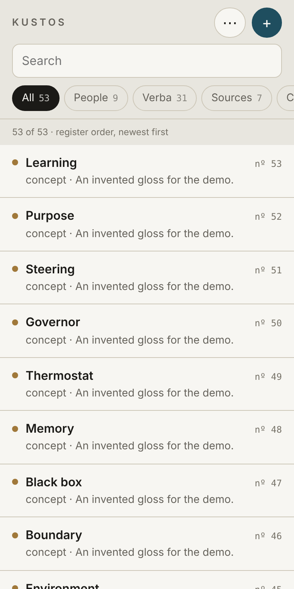
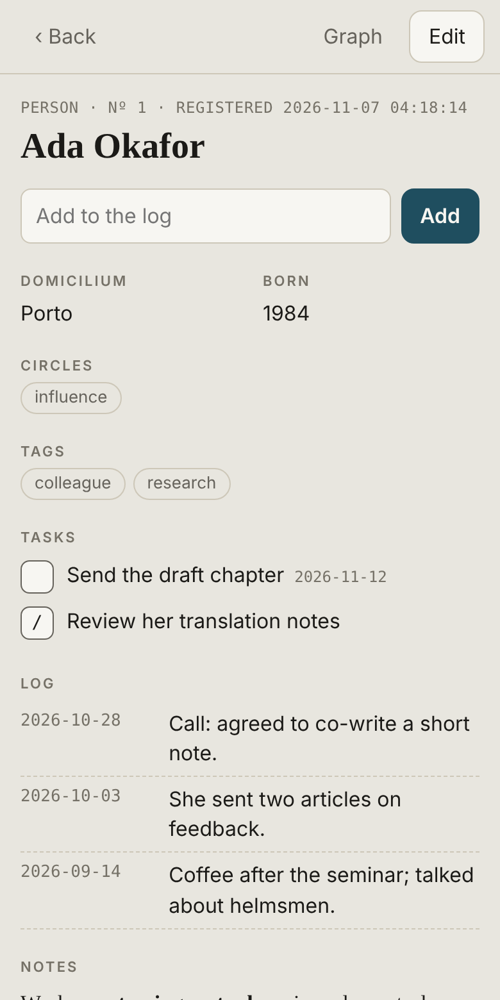
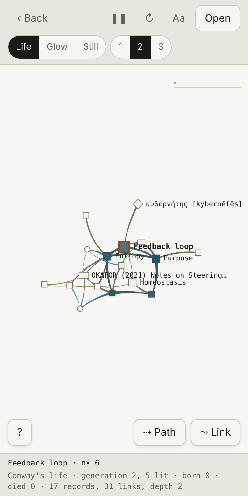
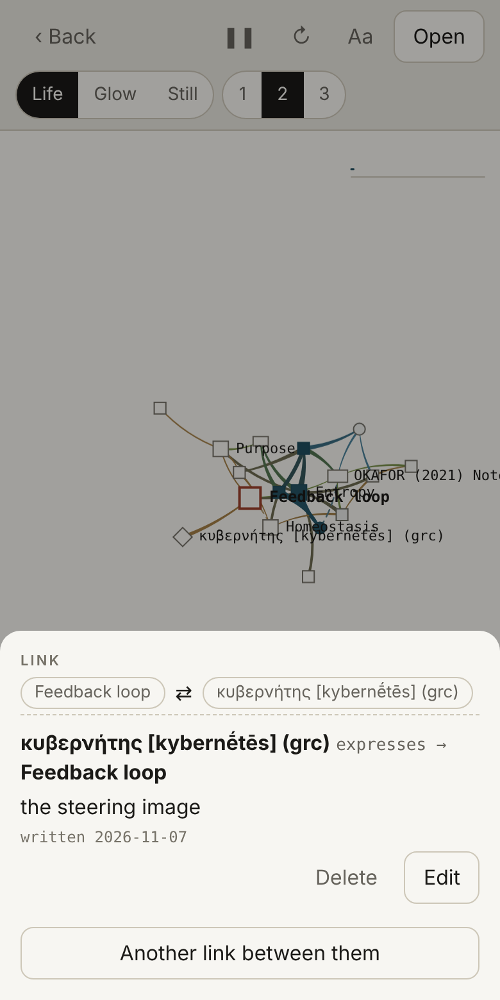
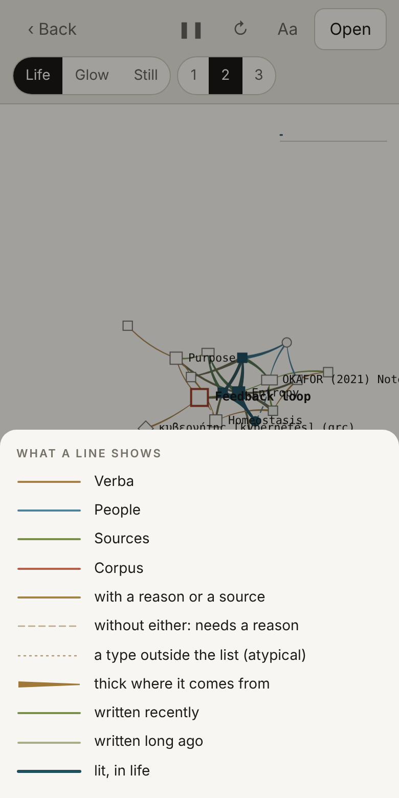
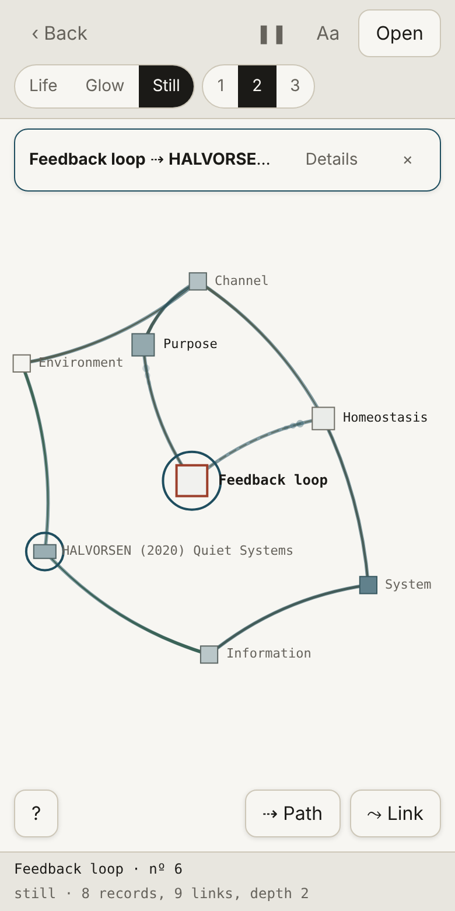
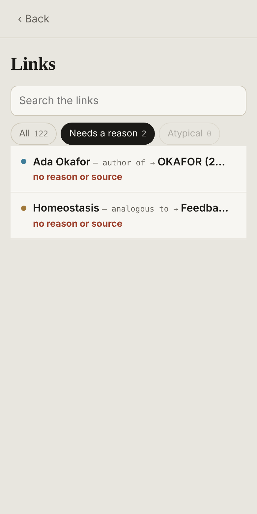
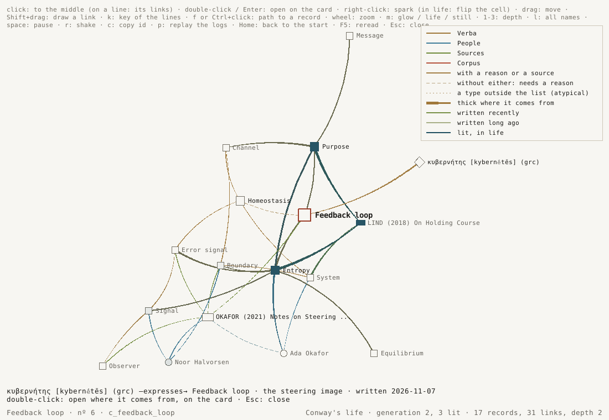
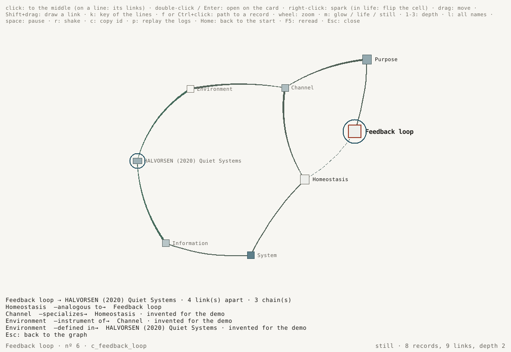

# Project Kustos

Project Kustos is a personal index of people, concepts, forms, sources, health tracking, all linked within the same base.

It's a python-based, Tk interface app, using .json files as the database set,
mirrored in markdown files capable of giving users readibility out of the
python ecosystem. Can be runned locally with synchronized folders, with automatic
updating of files and conflicts if used any syncing app or cloud sync.

## A look

All the pictures below are of an invented base, made up for the demo.

**On a phone** (`python _kustos.py web`): the list, a person's card, the link
graph in Conway's life, a link's card, the key of the lines, the path between
two records, and the links that still need a reason.

<p>




</p>
<p>



</p>

**In the window**: the link graph with the key of the lines and a link
selected, and the path finder with its steps written out.

<p>

</p>
<p>

</p>

## Requisites

- Python 3.10 or newer with Tkinter.

## How to use

1. Download `_kustos.py` and `_kustos.cmd` onto an empty folder.
2. Open `_kustos.cmd` to start using (or `_kustos_logbook.cmd` to read the base as a logbook, read-only; inside the app, `Ctrl+B` opens the logbook on the current entry and `Enter` in the logbook brings an entry back to the app). The empty folder will be the locus of files.
   On Windows you can also make a shortcut to `pythonw.exe "<folder>\_kustos.py"` with
   `kustos.ico` as its icon (`python tools/make_icon.py` draws it) and pin it to the
   Start menu or the taskbar.
3. Upon the first entry, the program creates the `_kustos.json` database. All files are local and don't leave your computer, unless you use a cloud or sync app.

### Trying it on invented data

`tools\demo.cmd` (from a copy of this repository: double-click it, or in
PowerShell type `.\tools\demo.cmd`) opens Kustos on a base of
invented records, the same as the web demo's, in `%TEMP%\kustos_demo`, apart
from your own folder: to try a change, to compare the window with the web page
on the same records (`tools\demo.cmd web`), or to take pictures you can share.
It always runs the repository's program; its records are kept, with anything
you add to them, until `tools\demo.cmd fresh`. `pt` or `en` sets the language.
It refuses any folder it did not make, so it never touches a real base.

## Components

- **Five collections** on the left menu, each with an unique ID:
  `p_` people · `c_` concept · `f_` form · `s_` source · `h_` health track ·
  `n_` draft.
- **Contacts**, for using Kustos as a personal CRM: a person's URLS hold one
  address per line, written as you would (`ana@example.org`,
  `+55 11 91234-5678`, `https://…`; `mailto:` and `tel:` work too), each
  optionally named (`work: …`, `mobile: …`). Kustos reads every line by its
  kind and keeps the text as typed: under the field, on the web page and as
  links in the mirror, each opens with what your computer or phone uses for
  it — the mail app, a call, the browser — and a phone written with `+` (or
  `00`) and its country code also gets a **WhatsApp** button. The search finds
  them, a phone number included.
- **Organizations** are people with *organization* ticked on the card (or
  **+ new › organization**; on the web, *Kind* in the form). They live with the
  people — register, search, graphs, Monads, web — are hexagons in the
  graphs, and have two link types of their own, *works at* and *member of*,
  from a person (or another organization) to them; as a person they can still
  be an author, or be known. The rail's **organizations** lists them, and
  `is:org` / `is:person` in the search pick them out.
- **Bulk entries** (`Ctrl+Q`, **File › Bulk entries…**): many records of one
  kind at once, one per line. Forms can come in several languages in one go:
  the language in parentheses after the name, or a line of its own (`(ita)`,
  `[ita]` or `# ita`) for the lines after it; a line with neither takes the
  LANGUAGE above. Flashcards copied from Obsidian (`questa:;this ^1748…`) are
  read too, the `^id` dropped:

  ```
  Domani (ita). tomorrow
  livre (fra); book
  (lat)
  aqua. water
  ignis. fire
  ```

  As you type, a line under the box says how many forms will go into each
  language (one the base does not have yet is marked *new*), which are already
  there — in the base or earlier in the list, same name and language, ignoring
  case — and will be skipped, and which have no language yet; Add refuses
  those until they get one. The `(ita)` is read only in the name, before the
  `. `, so a gloss such as `beautiful (adj)` keeps its parentheses.
- **Drafts**: free notes in markdown, one `.md` file each in `notes/` beside the
  program, so other markdown tools (Obsidian, say) read and edit the same
  files. The title is the file name; a small header (`id`, `reg_n`, `reg`,
  `tags`) lets Kustos follow a file renamed or moved inside `notes/`, and any
  other header field is kept. The JSON holds only an index entry per draft,
  never the text, so saving one does not rewrite the others; the log keeps the
  text of every save. A `.md` put into `notes/` comes in when Kustos opens or on
  `F5`. A file changed outside since it was opened is not overwritten without
  asking. Deleting moves the file to `notes/.deleted`. In a draft's text, in
  any record's NOTES and in reading mode: `Ctrl+B` bold, `Ctrl+I` italic, `Ctrl+K` `[[link]]`, `Ctrl+Backspace`/`Delete`
  a word, `Enter` continues a list or task, `Tab`/`Shift+Tab` indent it,
  `Alt+↑`/`Alt+↓` move lines, with a light markdown highlight. *as HTML* writes
  the draft as a page to read or print; **Base › Export drafts** puts them all
  in one markdown file. On Windows the drafts' text is cached in
  `%LOCALAPPDATA%\Kustos` (opening files is slow there), so only changed files
  are read again.
- **Linked entries** between any registers (`author_of`, `cites`,
  `attested_in`, `defined_in`, `translates`, `measured_in`…). Labels outside of the table are accepted and marked as atypical.
  Every card, a person's included, has a LINKS field, one link per line:
  `rel target [span] [@circle] — reason # source`, the target being a
  record's id (`Ctrl+Shift+C` copies the open record's). Below it, RESOLVED
  LINKS lists them by name and CITED BY the links coming in. Between two
  people, `knows` is for people who met, and `influenced` for one whose work
  shaped the other's, across any distance in time; `cites` points at a
  source, or at a person cited by name.

  ```
  influenced p_tom00002 1950 @influence — his notes on governors shaped hers
  cites p_ada00001 @concern — quoted by name, never met
  ```

  **A link's circle** (`@concern`, `@adapt`, `@influence`, `@control`) says
  where the record it points at sits in the circles of the record it starts
  from — the same four circles a person card holds for you, seen from that
  record instead. The first line above puts Tomás in this person's circle of
  influence. It shows in RESOLVED LINKS and CITED BY (*influenced · influence*),
  on the page, in the mirror and in both graphs' link cards and dialogs, and
  `circle:influence` in the search finds the records at either end of such a
  link, with the people in your own circle of influence.

  **From the other end**: `cited_by p_…` or `influenced_by p_…`, written on
  the card of the one cited or influenced, is the other record's link. It is
  saved with that record (where it then shows in LINKS), and here it moves to
  CITED BY: still one link, written from whichever card is open.

  The link graph draws them too (Shift+drag from one record to another).
- **Monads** (`Ctrl+Shift+M`, **View › Monads**, or `python _kustos.py monads [id]`):
  a second, read-only window that shows what records share with no link written,
  after Leibniz. Each person, concept, form or source is a disc and no line is
  drawn: what they have in common comes from the words they use (the rarer, the
  more it counts) and from the links that exist. The nearer a disc, the more
  clearly the one in the middle perceives it; the rest of the base stays as dust
  at the edge. The dots inside a disc are what it perceives, on the side where
  each is. Passing over a disc shows the others from its side and says what it
  shares with the middle; a click moves there, `←` `→` walk back and forward, the
  wheel zooms, `k` filters by kind, `1`-`3` show more or fewer, Enter opens the
  record on the card. All the rims breathe on one clock. Health and drafts stay
  out, and nothing it computes is saved; `F5` rereads what was edited since.
- **Link graph** (`Ctrl+Shift+G`, **View › Link graph**, or `python _kustos.py graph [id]`):
  a second window with the open record in the middle and the records
  one to three links away around it, laid out by springs that settle by
  themselves. It follows the record you open in the main window. It looks and
  is worked like the web page's graph: buttons at the top switch the rule and
  the depth (1–3), pause, reseed, show every name (**Aa**) and open the middle
  record; **?**, **⇢ Path** and **⤳ Link** float at its foot; a hint above the
  graph goes after the first click, and in life a small line at the top right
  follows how many are lit. Every button has its key too. The records
  glow and the glow changes as it runs, by one of three rules (`m` switches):
  *Conway's life* (the default: the Game of Life with the links as neighbours —
  a lit record stays lit with 2 or 3 lit neighbours, a dark one lights with
  exactly 3, a generation every 1.2 s; a birth is fed by its lit neighbours,
  whose light flows along the links into it; when the pattern dies out or
  settles the run rests, the survivors lit, until ↻ or `r` starts it again),
  *spreading glow* (light runs along the links and fades, fed by recent edits
  and by sparks) and *still*. Nothing jumps: when the middle changes, the
  records already there keep their place and light, new ones sprout beside the
  record that brought them and their links grow out to them, the ones that
  leave wither; links are soft curves; every brightness eases. Click a record
  to bring it to the middle; double-click or `Enter` opens it on the card;
  right-click sparks it (in life mode it flips the cell); dragging a record
  moves it while its neighbours follow gently and the view holds still. It
  shows at most 160 records at a time. The web version's graph moves the same.
  `p` **replays the logs**: the base grows on screen as it grew, records
  appearing when they were first saved, links when they were written, each
  edit a flash, with a timeline below (click or drag it to go to a moment;
  `space` pauses, `+`/`-` change the speed, `←`/`→` skip). `w` switches between
  the whole base (what was being worked on, and what it links to) and only the
  records that were on screen when the replay began. Records saved before
  there were logs open the timeline. `Esc` goes back to the live graph.
- **What a link line shows**, in the graph (window and web alike): its
  *colour* is the family of its type (verba, people, sources, corpus), *how
  vivid* it is says how recently it was written (from the logs), its *stroke*
  says what backs it — solid with a reason or a source, dashed with neither
  (a link that still needs a reason), dotted for a type outside the list — and
  a *taper*, thick at the record it comes from, gives its direction (two-way
  types like *knows* stay even). The types of the middle record's links (or
  of the one under the pointer) are written on their lines, when it has at
  most a dozen. **?** (or `k` in the window) shows the key. Click a line (tap,
  on the web) to read its links: type, reason, source, span, when written. In
  the window, double-click the line to open the record it comes from on the
  card. **⤳ Link** turns dragging from one record to another into drawing a
  new link (in the window, Shift+drag does it too): type, reason, source,
  span; only the types that fit the two records are offered, and one that
  does not fit is refused. On the web the link card edits and deletes links
  too, and **⋯ › Links** lists every link, with *Needs a reason* and
  *Atypical* as filters. A link is always saved as a change of the record it
  comes from, with its log line, as when typed in its LINKS field.
- **Path finder** — how are two records related? In the graph (window and web
  alike), **⇢ Path** (or `f` in the window) asks for a record by a few
  letters of its name; `Ctrl+click` on a record in the window, or *Tap a record
  in the graph* on the web, takes it straight from the graph. The graph then
  shows only the shortest chains of links between the middle record and that
  one — up to three, all of the same length, eight links at most — still, a
  light running along them from one end to the other, both ends ringed. The
  steps are written out (in the window above the status line; on the web
  under *Details*, where a step opens its link card). `Esc` in the window, `×`
  on the web, goes back to the neighbourhood. When no chain joins the two, it
  says so.
- **Timeline** (`Ctrl+Shift+T`, **View › Timeline**, or `python _kustos.py
  timeline [id]`): everything dated on one line of time, in lanes — the
  people's LOG (the facts of a life), births and deaths (`BORN` / `DIED` on the
  person card), tasks due, when sources came out, links with a
  span (`-800/400`), health readings, sessions, events and medicines, and
  drafts with a `date` or `period` in their header. From centuries to minutes:
  the wheel zooms where the pointer is, dragging moves along, `Home` shows
  everything, `t` today, `r` adds when each record was registered. It follows
  the main window's search and filters (`f` switches), and `Enter` opens the
  chosen record on the card. A LOG line may carry a year (`2021`), a month
  (`2024-03`) or a time (`2024-03-11 14:30`). **Base › Real dates in the logs**
  (or `python _kustos.py real-dates [apply [order]]`) finds log entries whose
  text starts with a date — as imported notes have it, `20240311…` — and, on
  confirmation, makes it the entry's date.
- **Peritia, the skills panel** (`_kustos_peritia.cmd`, **View › Skills (Peritia)**,
  or `python _kustos.py peritia`): the *Skills* page of the web version below,
  served by the same server with the same protections — `/skills` beside the
  base at `/`, reached from the base's menu, with **← Kustos** back. A record
  a skill links to opens in Kustos, and a record's page lists the skills that
  point at it, with their level, each leading to the skill. Skills
  (`k_`) sit on a star chart, domains as sectors and prerequisites as rings;
  each has a journal of *study*, *practice* and *proof* entries (a proof asks
  for a reference: a file that runs, a link, or a Kustos id), which add up to
  XP and to a level from I to V named after Dreyfus (from III up, XP alone is
  not enough: it takes proofs). Brightness shows freshness, and a level never
  falls. The *Foundations* page explains where each rule comes from and lets
  you change its numbers, keeping a dated history of every change. Skills
  live in `_kustos.json` beside the rest, link to any record, and go through
  the same log and conflict merge, but outside the register. A skill saved
  over a version that changed on disk is refused and the current one
  reloaded. `_kustos_peritia.html` is a read-only snapshot, rewritten on every
  change; a `_peritia.json` from the panel's standalone days can be imported.
- **Behind a login, for your own devices** (`python _kustos.py web --serve`):
  the same web version, long-running, asking for a password and a 6-digit
  code from an authenticator app before anything else. Meant to be reached
  only through [Tailscale](https://tailscale.com) (`tailscale serve` in front
  of it), so that nothing is open to the internet and the data never leaves
  your machines; it still listens on 127.0.0.1 only. Set it up once, on the
  machine that serves it:

  ```
  python _kustos.py passwd            # a password (12+ characters), then the code
  python _kustos.py web --serve       # http://127.0.0.1:8484, behind the login
  ```

  `passwd` shows a key to type into the authenticator app (Aegis, 2FAS,
  Google Authenticator, 1Password…) and asks for its code to confirm. The
  password's hash and the key are kept in a file of that machine's own
  (`%LOCALAPPDATA%\Kustos`), never in the synced folder nor in git. A session
  lasts 12 hours without use (14 days at most), in a cookie the page's scripts
  cannot read; a restart, a new password or `passwd --logout-all` ends every
  session; *Log out* is in the menu. Five wrong tries in 15 minutes close the
  login for 15 minutes, then 30, and so on; every login, failure and lockout
  is logged on that machine (`passwd --status` shows the last ones). A code
  works once. The plain `web` the window opens stays as it was: this machine
  only, no login.

  **Always on, from your phone** (Windows): with Tailscale installed and
  signed in on the machine (MagicDNS and HTTPS certificates on, in its admin
  console), run **`_kustos_serve.cmd`** in the Kustos folder. It asks for the
  password if none is set, makes `web --serve` start at every login of that
  Windows user, in the background (a scheduled task, *Kustos web*), allows
  the machine's Tailscale address, puts `tailscale serve` in front of it and
  checks that the login answers; it ends with the address to open on the
  phone, `https://<machine>.<tailnet>.ts.net` (Tailscale on there too; *https*,
  not http). `_kustos_serve.cmd status` says whether it runs and lists the
  last logins; `stop`, `start` and `remove` do what they say. Updating the
  program (`tools\update-instance.cmd`) restarts it on the new version.
  Never `tailscale funnel`: that would open it to the internet.
- **Web version** (`python _kustos.py web`): the whole base in the browser,
  laid out for a phone as much as for a desk, served by Kustos itself on
  127.0.0.1 only; it stops two minutes after the page is closed (`--stay`
  keeps it up). Search with the same operators as the window, the five
  collections as tabs, every record readable and editable, new records of
  every kind, and on the card quick entries: a line in a person's LOG, a
  reading, a session; tick a task and it goes to the log. The fields hold the
  same text as the window's cards (a LOG line, a task line, a link line), and
  saving goes the same way — register, log, mirror — so both can be used on
  the same base. A record changed on disk since the page opened it (in the
  window, or synced from another machine) is not overwritten without asking.
  The menu opens the health report and the body map.
  The **link graph** is there too (*Graph* on a record, or *Link graph* in the
  menu): the same records, shapes and springs as the window's, with Conway's
  life first — a lit record fills with the accent and its links to other lit
  records thicken, and a small line in the corner follows how many are lit.
  As in the window: a generation every 1.2 s, and when the pattern dies out or
  settles it stops there, the survivors still lit, until *Reseed* (or holding
  a record) starts it again. Changes grow rather than
  jump: a new middle keeps the light of the records already there, new ones
  sprout from the record that brought them and their links grow out to them,
  the ones that leave wither; a birth is fed by its three lit neighbours,
  whose light flows along the (softly curved) links into it. Tap a record
  to bring it to the middle, tap the middle to open it, hold one to flip its
  cell (a grab that moves is a drag, never a hold), drag one to move it — its
  neighbours follow gently and the view holds still — pinch or scroll to
  zoom; *Life / Glow / Still* and the depth 1–3 sit
  above it. (The replay of the logs is still only in the window.)
- **Geographic location (GEO)**: every card but the draft's has a GEO field.
  Write a point as a GPS or a map shows it, latitude then longitude in decimal
  degrees (WGS 84), with a label after it if you like, one point per line:

  ```
  -19.9167, -43.9345  office
  geo:-19.92,-43.94
  ```

  A map link carrying `@lat,lon` is read too, and for a line or an area you
  paste GeoJSON whole (a geometry, a Feature or a FeatureCollection, as QGIS
  or geojson.io give it; GeoJSON itself writes longitude first). The line under
  the field says what it reads as, or what does not read; the doctor lists any
  GEO that does not. `is:geo` in the search keeps the records that have one.
  `python _kustos.py geojson` writes them all as `_kustos.geojson`, one feature
  per point or shape with the record's id, number and name, to open in QGIS or
  load into PostGIS (`ogr2ogr -f PostgreSQL PG:dbname=… _kustos.geojson`);
  health records stay out unless you add `--all`. Nothing goes to the network:
  no geocoding, no map tiles.
- **Source**: free types (book, paper, thesis, law/bill, decisions, webpages, videos), citations in academic formats, BibTeX and CSL-JSON.
  Can import from Zotero via CSL-JSON or BibTeX without duplicating entries.
- **Health (corpus)**: four kinds of record, each with its own fields —
  *measurements* (unit, reference range, dated readings with a trend curve),
  *medications* (dose, frequency, since/until, prescriber, purpose),
  *activities and habits* (aim and a diary of sessions) and *events*
  (consultations, exams, symptoms, procedures, vaccines). A minimalist
  Vitruvian body map shows the systems involved. **Base › Health report** (or
  `python _kustos.py health`) writes `_kustos_health.html` with two views:
  *Consultation* (medications in use, latest values with their status, recent
  events, current activities) and *Follow-up* (trends, sessions per week, full
  history); printing prints the view on screen.
- **Register number**, similar to notary and public registry systems: on its
  first save, every entry gets a stamp (`YYYYMMDDHHmmss`) and a sequential
  order number (`nº 1852`). The number never changes and is never reused;
  deleting an entry keeps its number in the sequence, marked as cancelled.
  Without a search, the list is the register itself, in number order.
- **No scrolling**: the list shows exactly as many rows as fit the window and
  pages through the rest (PageUp/PageDown or the mouse wheel turn a page).
- **Reading long notes**: `Ctrl+E` (or a double-click on a field's title) opens
  the field across the whole card, read in pages with PageUp/PageDown or the
  wheel, with `Ctrl+F` to find inside it; it stays editable. `F11` hides the
  rail and the list so the card takes the whole window; the text column keeps
  a readable width. There, `Ctrl+F` shows what the search finds in a small list
  under it — the index's own results — chosen with ↑ ↓ (or the mouse) and
  opened with Enter, Esc to put it away, without leaving the wide card. A long LOG or NOTES field is read one page per view
  inside the card: each page holds what fits on screen and starts at an entry
  or paragraph (`‹ ›` beside the title, PageUp/PageDown, a sideways swipe or
  Shift+wheel over it, or the wheel over it once the card is at its end); the
  LOG opens on the newest. Otherwise the wheel and the touchpad scroll the card,
  whatever field is under the pointer. **View › Long texts › Continuous**
  makes them scroll instead.
- **Search**, the "indexer": results come in alphabetic order, paged, each with its register number, with operators of search:

  ```
  p: v: f: c: d:                    only people / verba / sources / body tracks / drafts
  ^ab                               name that starts with "ab"
  tag:x lang:de type:book sys:renal dom:law id:c_
  is:org is:person is:geo           organizations / people who are not / records with a GEO
  circle:influence                  in your circle of influence, or at either end of a link in it
  ```

  The search always runs over the whole base. The rail keeps every category
  visible and its numbers count what the search finds (categories with nothing
  are dimmed), so a search in one collection shows at once where else it
  matches. The filters in force sit as chips above the list: `×` drops one,
  *clear all* drops them all.

- **Dust off** (`Ctrl+D`, the *dust off* button beside *+ new*, or **View ›
  Dust off**): opens the record gone longest without a visit, among those in
  the list — the whole register, or what the search and the filters leave
  (`Ctrl+5` first, and it goes through the drafts only; `v: lang:ita`, the
  Italian forms). Not at random: oldest first, so pressing it again and again
  goes through them all, each one opened going to the back of the line. A
  visit is a card left open a few seconds (not one passed by on the way), a
  save, or one opened this way; the status line says when the last one was
  and how many more in the list have gone a month without one. The visits are
  kept per machine beside the base (`_kustos.seen.<machine>.json`, only this
  machine writes its own, so Syncthing never makes a conflict of it), and
  every machine reads them all.

- **Sync between machines**: each machine that you end up using and syncing will write its own diary of usage
  (`_kustos.log.<machine>.jsonl`); files `*.sync-conflict-*` are mixed register by register on opening. The complete history of each register comes out in the diaries.

## Language

The interface is in English. Portuguese is available under **View › Language**
(saved as `ui.lang` in `_kustos.json`); the window reopens in the chosen
language. Your data is never translated: source types and corpus systems are
stored under their original keys and only *shown* in the interface language.
ABNT citations stay in Portuguese, as the standard itself is.

## Command lines (optional)

```
python _kustos.py doctor                data-health check
python _kustos.py search <texto>
python _kustos.py cite <id|texto> [abnt|abnt-autor-data|bibtex|csl-json|bruto]  pulls citation from source
python _kustos.py export [bibtex|csl|abnt] [arquivo]
python _kustos.py geojson [--all] [file]   every GEO as one GeoJSON file
python _kustos.py import zotero <export.json|.bib>
python _kustos.py mirror | corpus | merge | history <id> | replay
python _kustos.py logbook                  the base as a logbook (read-only)
python _kustos.py peritia [--no-open] [--port N]   the web version, opened on its Skills page
python _kustos.py web [--stay] [--no-open] [--port N]   the whole base, in the browser (phone or desk)
python _kustos.py web --serve [--port N] [--allow-host NAME]   the same, behind a login
python _kustos.py passwd [--no-code | --status | --logout-all | --remove]
python _kustos.py service [install | status | stop | start | restart | remove]   Windows: web --serve at every login
```

## Suggestion: Using Syncthing to sync

Suggestion for the `.stignore` of folder, if synced with Syncthing:

```
*.tmp
_kustos.replay.json
_kustos_fontes.*
__pycache__
```

## License

MIT. See [LICENSE](LICENSE).
