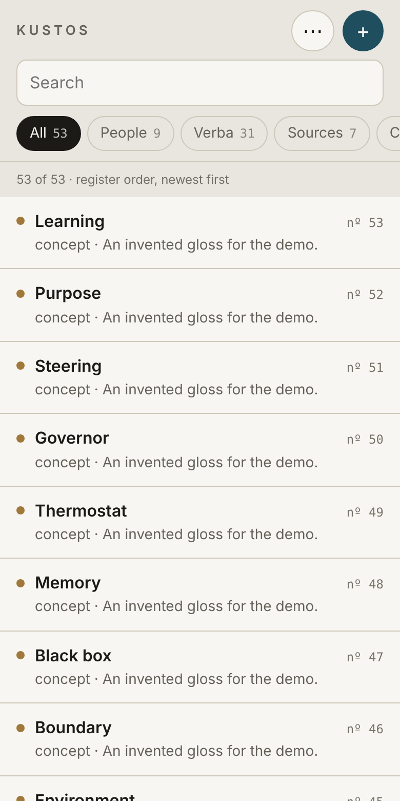
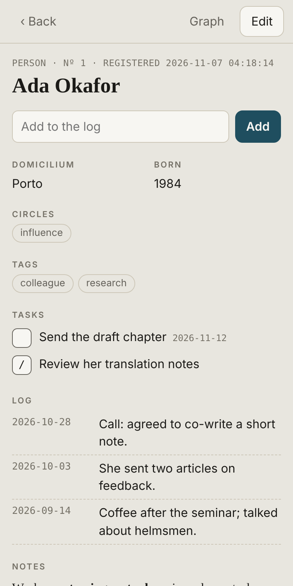
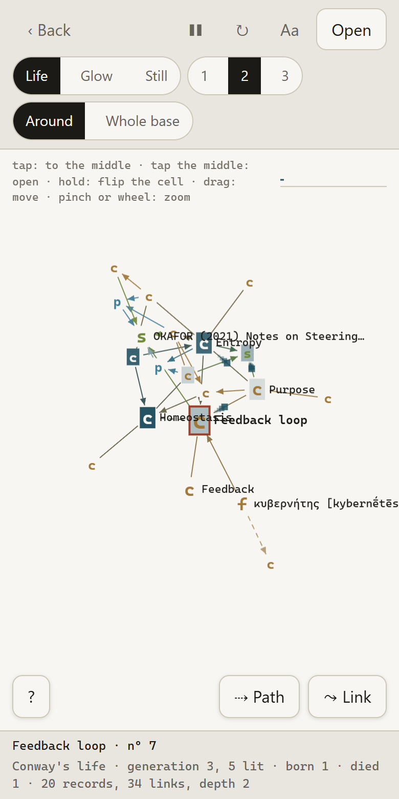
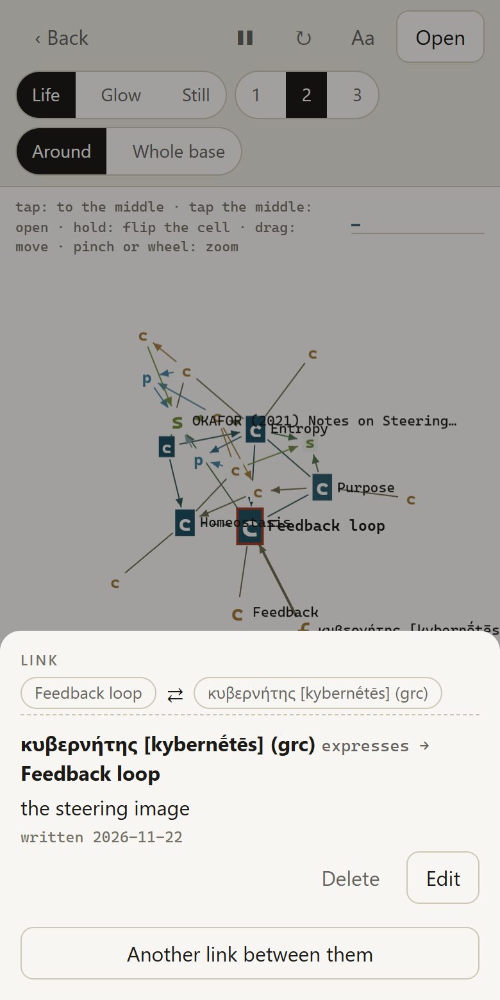
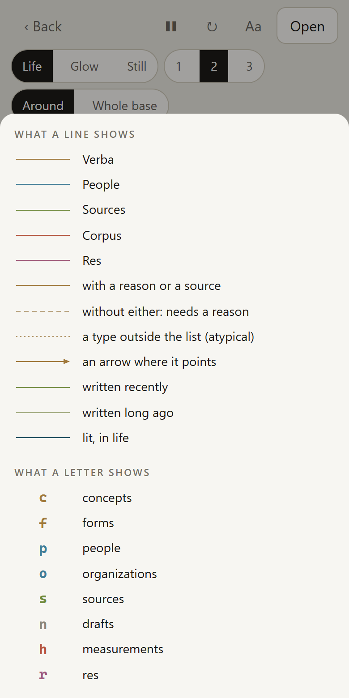
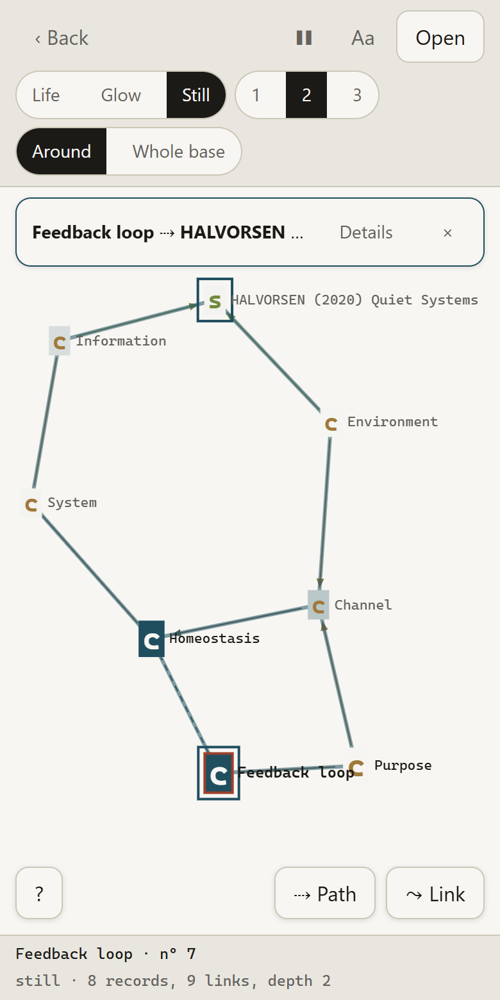
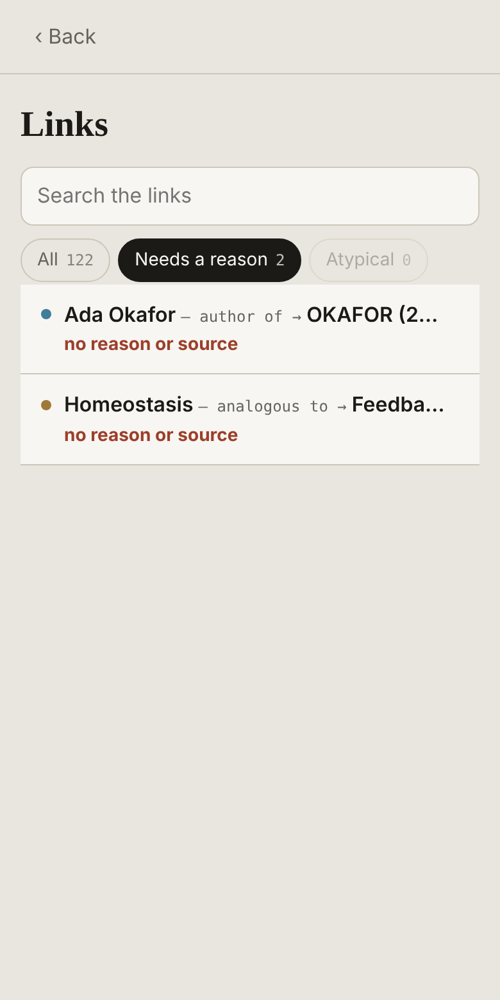
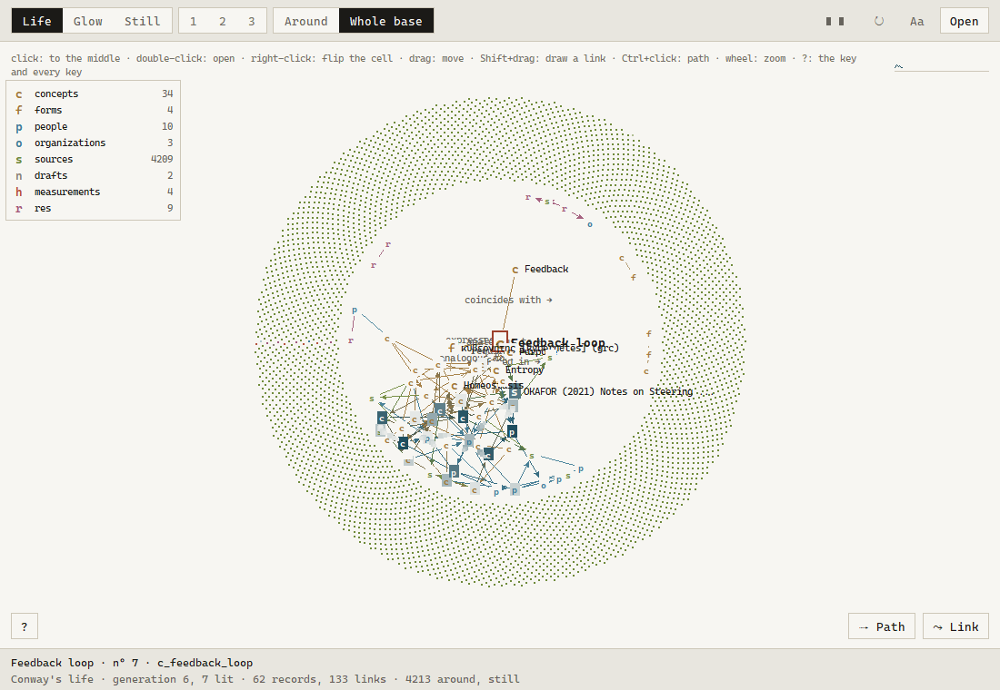
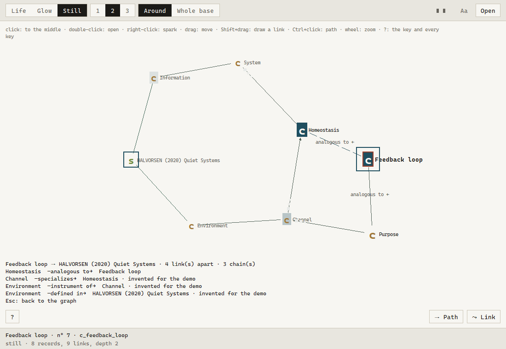

# Project Kustos

Project Kustos is a personal index of people, concepts, forms, sources, health tracking, all linked within the same base.

This README is the whole documentation: how to use Kustos first, then, under
[Working on the code](#working-on-the-code), how it is built and how a change is
made -- the part that also guides Claude, the coding assistant, in every session
on this repository.

It's a python-based, Tk interface app, using .json files as the database set,
mirrored in markdown files capable of giving users readibility out of the
python ecosystem. Can be runned locally with synchronized folders, with automatic
updating of files and conflicts if used any syncing app or cloud sync.

## A look

All the pictures below are of an invented base, made up for the demo.

**On a phone** (`python _kustos.py web`): the list, a person's card, the link
graph in Conway's life, a link's card, the key of the lines and letters, the
path between two records, and the links that still need a reason.

<p>




</p>
<p>



</p>

**In the window**: the link graph showing the whole base -- the linked
records on the springs, every other one still around them (here with four
thousand invented sources added), the key of the records at the left -- and
the path finder with its steps written out.

<p>

</p>
<p>

</p>

## Requisites

- Python 3.10 or newer with Tkinter.

## How to use

1. Download `_kustos.py` and `_kustos.cmd` onto an empty folder.
2. Open `_kustos.cmd` to start using (or `_kustos_logbook.cmd` to read the base as a logbook, read-only; inside the app, `Ctrl+B` opens the logbook on the current entry and `Enter` in the logbook brings an entry back to the app). The empty folder will be the locus of files.
   On Windows you can also make a shortcut to `pythonw.exe "<folder>\_kustos.py"` with
   `kustos.ico` as its icon (`python tools/make_icon.py` draws it) and pin it to the
   Start menu or the taskbar.
3. Upon the first entry, the program creates the `_kustos.json` database. All files are local and don't leave your computer, unless you use a cloud or sync app.

### Trying it on invented data

`tools\demo.cmd` (from a copy of this repository: double-click it, or in
PowerShell type `.\tools\demo.cmd`) opens Kustos on a base of
invented records, the same as the web demo's, in `%TEMP%\kustos_demo`, apart
from your own folder: to try a change, to compare the window with the web page
on the same records (`tools\demo.cmd web`), or to take pictures you can share.
It always runs the repository's program; its records are kept, with anything
you add to them, until `tools\demo.cmd fresh`. `pt` or `en` sets the language.
It refuses any folder it did not make, so it never touches a real base.

## Components

- **Six collections** on the left menu, each with an unique ID:
  `p_` people · `c_` concept · `f_` form · `s_` source · `h_` health track ·
  `n_` draft · `r_` thing (res).
- **Contacts**, for using Kustos as a personal CRM: a person's URLS hold one
  address per line, written as you would (`ana@example.org`,
  `+55 11 91234-5678`, `https://…`; `mailto:` and `tel:` work too), each
  optionally named (`work: …`, `mobile: …`). Kustos reads every line by its
  kind and keeps the text as typed: under the field, on the web page and as
  links in the mirror, each opens with what your computer or phone uses for
  it — the mail app, a call, the browser — and a phone written with `+` (or
  `00`) and its country code also gets a **WhatsApp** button. The search finds
  them, a phone number included.
- **Organizations** are people with *organization* ticked on the card (or
  **+ new › organization**; on the web, *Kind* in the form). They live with the
  people — register, search, graphs, Monads, web — are an *o* in the
  graphs, and have two link types of their own, *works at* and *member of*,
  from a person (or another organization) to them; as a person they can still
  be an author, or be known. The rail's **organizations** lists them, and
  `is:org` / `is:person` in the search pick them out.
- **Bulk entries** (`Ctrl+Q`, **File › Bulk entries…**): many records of one
  kind at once, one per line. Forms can come in several languages in one go:
  the language in parentheses after the name, or a line of its own (`(ita)`,
  `[ita]` or `# ita`) for the lines after it; a line with neither takes the
  LANGUAGE above. Flashcards copied from Obsidian (`questa:;this ^1748…`) are
  read too, the `^id` dropped:

  ```
  Domani (ita). tomorrow
  livre (fra); book
  (lat)
  aqua. water
  ignis. fire
  ```

  As you type, a line under the box says how many forms will go into each
  language (one the base does not have yet is marked *new*), which are already
  there — in the base or earlier in the list, same name and language, ignoring
  case — and will be skipped, and which have no language yet; Add refuses
  those until they get one. The `(ita)` is read only in the name, before the
  `. `, so a gloss such as `beautiful (adj)` keeps its parentheses.
- **Drafts**: free notes in markdown, one `.md` file each in `notes/` beside the
  program, so other markdown tools (Obsidian, say) read and edit the same
  files. The title is the file name; a small header (`id`, `reg_n`, `reg`,
  `tags`) lets Kustos follow a file renamed or moved inside `notes/`, and any
  other header field is kept. The JSON holds only an index entry per draft,
  never the text, so saving one does not rewrite the others; the log keeps the
  text of every save. A `.md` put into `notes/` comes in when Kustos opens or on
  `F5`. A file changed outside since it was opened is not overwritten without
  asking. Deleting moves the file to `notes/.deleted`. In a draft's text, in
  any record's NOTES and in reading mode: `Ctrl+B` bold, `Ctrl+I` italic, `Ctrl+K` `[[link]]`, `Ctrl+Backspace`/`Delete`
  a word, `Enter` continues a list or task, `Tab`/`Shift+Tab` indent it,
  `Alt+↑`/`Alt+↓` move lines, with a light markdown highlight. *as HTML* writes
  the draft as a page to read or print; **Base › Export drafts** puts them all
  in one markdown file. On Windows the drafts' text is cached in
  `%LOCALAPPDATA%\Kustos` (opening files is slow there), so only changed files
  are read again.
- **Linked entries** between any registers (`author_of`, `cites`,
  `attested_in`, `defined_in`, `translates`, `measured_in`…). Labels outside of the table are accepted and marked as atypical.
  Every card, a person's included, has a LINKS field, one link per line:
  `rel target [span] [@circle] — reason # source`, the target being a
  record's id (`Ctrl+Shift+C` copies the open record's). Below it, RESOLVED
  LINKS lists them by name and CITED BY the links coming in. Between two
  people, `knows` is for people who met, and `influenced` for one whose work
  shaped the other's, across any distance in time; `cites` points at a
  source, or at a person cited by name.

  ```
  influenced p_tom00002 1950 @influence — his notes on governors shaped hers
  cites p_ada00001 @concern — quoted by name, never met
  ```

  **A link's circle** (`@concern`, `@adapt`, `@influence`, `@control`) says
  where the record it points at sits in the circles of the record it starts
  from — the same four circles a person card holds for you, seen from that
  record instead. The first line above puts Tomás in this person's circle of
  influence. It shows in RESOLVED LINKS and CITED BY (*influenced · influence*),
  on the page, in the mirror and in both graphs' link cards and dialogs, and
  `circle:influence` in the search finds the records at either end of such a
  link, with the people in your own circle of influence.

  **From the other end**: `cited_by p_…` or `influenced_by p_…`, written on
  the card of the one cited or influenced, is the other record's link. It is
  saved with that record (where it then shows in LINKS), and here it moves to
  CITED BY: still one link, written from whichever card is open.

  The link graph draws them too (Shift+drag from one record to another).
- **Monads** (`Ctrl+Shift+M`, **View › Monads**, or `python _kustos.py monads [id]`):
  a second, read-only window that shows what records share with no link written,
  after Leibniz. Each person, concept, form or source is a disc and no line is
  drawn: what they have in common comes from the words they use (the rarer, the
  more it counts) and from the links that exist. The nearer a disc, the more
  clearly the one in the middle perceives it; the rest of the base stays as dust
  at the edge. The dots inside a disc are what it perceives, on the side where
  each is. Passing over a disc shows the others from its side and says what it
  shares with the middle; a click moves there, `←` `→` walk back and forward, the
  wheel zooms, `k` filters by kind, `1`-`3` show more or fewer, Enter opens the
  record on the card. All the rims breathe on one clock. Health and drafts stay
  out, and nothing it computes is saved; `F5` rereads what was edited since.
  When the discs in view are signed by more than one observator, those signed
  by someone other than this base's get a dashed ring in that observator's
  colour, with a small legend (bottom right); passing over one names its signer.
- **Link graph** (`Ctrl+Shift+G`, **View › Link graph**, or `python _kustos.py graph [id]`):
  a second window with the open record in the middle and the records
  one to three links away around it, laid out by springs that settle by
  themselves. It follows the record you open in the main window. It is drawn
  as a terminal would: every record is the letter its id starts with — *c* a
  concept, *f* a form, *p* a person, *o* an organization, *s* a source, *n* a
  draft, *h* a measurement, *r* a thing of the house — in its collection's
  colour, a lit one in inverse video, the middle one boxed; every link is a
  straight line one pixel wide. It looks and
  is worked like the web page's graph: buttons at the top switch the rule,
  the depth (1–3) and the scope (*Around* / *Whole base*), pause, reseed,
  show every name (**Aa**) and open the middle
  record; **?**, **⇢ Path** and **⤳ Link** float at its foot; a hint above the
  graph goes after the first click, and in life a small line at the top right
  follows how many are lit. Every button has its key too. The records
  glow and the glow changes as it runs, by one of three rules (`m` switches):
  *Conway's life* (the default: the Game of Life with the links as neighbours —
  a lit record stays lit with 2 or 3 lit neighbours, a dark one lights with
  exactly 3, a generation every 1.2 s; a birth is fed by its lit neighbours,
  whose light flows along the links into it; when the pattern dies out or
  settles the run rests, the survivors lit, until ↻ or `r` starts it again),
  *spreading glow* (light runs along the links and fades, fed by recent edits
  and by sparks) and *still*. Nothing jumps: when the middle changes, the
  records already there keep their place and light, new ones sprout beside the
  record that brought them and their links grow out to them, the ones that
  leave wither; every brightness eases. Click a record
  to bring it to the middle; double-click or `Enter` opens it on the card;
  right-click sparks it (in life mode it flips the cell); dragging a record
  moves it while its neighbours follow gently and the view holds still.
  Around a record it shows at most 160 records at a time. **Whole base** (`w`,
  or the button at the top) shows them all: every record with a link lives on
  the springs as above (the largest connected groups first, up to 160), and
  every other one lies still around them in a disc, one wedge per type, the
  most recently edited nearest the middle. From afar the still ones are dots
  in their type's colour; closer, their letters in a small pixel font. Pass
  over one to read its name; click it to make it the middle, and the view
  glides there. The key of the records, top left (with the whole base, or
  with `k`), counts each type; a click on a type hides it or brings it back,
  around a record as in the whole base. The web version's graph moves the same.
  `p` **replays the logs**: the base grows on screen as it grew, records
  appearing when they were first saved, links when they were written, each
  edit a flash, with a timeline below (click or drag it to go to a moment;
  `space` pauses, `+`/`-` change the speed, `←`/`→` skip). `w` switches between
  the whole base (what was being worked on, and what it links to) and only the
  records that were on screen when the replay began. Records saved before
  there were logs open the timeline. `Esc` goes back to the live graph.
- **What a link line shows**, in the graph (window and web alike): its
  *colour* is the family of its type (verba, people, sources, corpus), *how
  vivid* it is says how recently it was written (from the logs), its *stroke*
  says what backs it — solid with a reason or a source, dashed with neither
  (a link that still needs a reason), dotted for a type outside the list — and
  an *arrowhead* where it points gives its direction (two-way types like
  *knows* have none). The types of the middle record's links (or
  of the one under the pointer) are written on their lines, when it has at
  most a dozen. **?** (or `k` in the window) shows the key, of the lines
  and of what each letter is. Click a line (tap,
  on the web) to read its links: type, reason, source, span, when written. In
  the window, double-click the line to open the record it comes from on the
  card. **⤳ Link** turns dragging from one record to another into drawing a
  new link (in the window, Shift+drag does it too): type, reason, source,
  span; only the types that fit the two records are offered, and one that
  does not fit is refused. On the web the link card edits and deletes links
  too, and **⋯ › Links** lists every link, with *Needs a reason* and
  *Atypical* as filters. A link is always saved as a change of the record it
  comes from, with its log line, as when typed in its LINKS field.
- **Path finder** — how are two records related? In the graph (window and web
  alike), **⇢ Path** (or `f` in the window) asks for a record by a few
  letters of its name; `Ctrl+click` on a record in the window, or *Tap a record
  in the graph* on the web, takes it straight from the graph. The graph then
  shows only the shortest chains of links between the middle record and that
  one — up to three, all of the same length, eight links at most — still, a
  light running along them from one end to the other, both ends ringed. The
  steps are written out (in the window above the status line; on the web
  under *Details*, where a step opens its link card). `Esc` in the window, `×`
  on the web, goes back to the neighbourhood. When no chain joins the two, it
  says so.
- **Timeline** (`Ctrl+Shift+T`, **View › Timeline**, or `python _kustos.py
  timeline [id]`): everything dated on one line of time, in lanes — the
  people's LOG (the facts of a life), births and deaths (`BORN` / `DIED` on the
  person card), tasks due, when sources came out, links with a
  span (`-800/400`), health readings, sessions, events and medicines, and
  drafts with a `date` or `period` in their header. From centuries to minutes:
  the wheel zooms where the pointer is, dragging moves along, `Home` shows
  everything, `t` today, `r` adds when each record was registered. It follows
  the main window's search and filters (`f` switches), and `Enter` opens the
  chosen record on the card. A LOG line may carry a year (`2021`), a month
  (`2024-03`) or a time (`2024-03-11 14:30`). **Base › Real dates in the logs**
  (or `python _kustos.py real-dates [apply [order]]`) finds log entries whose
  text starts with a date — as imported notes have it, `20240311…` — and, on
  confirmation, makes it the entry's date.
- **Practice languages** (the web version's menu › *Practice*, on the phone as
  on the desk, or **View › Practice languages**): the verba drilled in their
  languages. A meaning is shown — a concept, or for a form linked to no
  concept its gloss — and you type the word, or say it aloud and grade
  yourself; then you hear it. Every form that expresses the concept in that
  language counts as right; a missing accent, ł/ß or article is *almost*.
  Words come back after 0, 1, 3, 7 and 21 days as you get them right (back to
  the start when wrong), with at most 15 new ones a day; choose the languages
  on the page. The answers go to `_kustos.drill.<machine>.jsonl`, never into a
  record, so practising changes nothing in the base.
  A concept and its forms in every language go in with one line of the bulk
  entry (`Ctrl+Q`, kind *concept*):

  ```
  água | o líquido que se bebe: woda (pol); das Wasser (deu); l'acqua (ita)
  ```

  It reuses a concept or form already there and only adds the missing links.
  **Voices**: the page speaks with your device's own offline voices; for
  better ones, [Piper](https://github.com/OHF-Voice/piper1-gpl) makes a
  recording of every word on the machine that runs Kustos, and the page —
  the phone's too — plays those instead:

  ```
  python -m pip install piper-tts
  python _kustos.py voices              which languages have a voice, and how many words have sound
  python _kustos.py voices get ita      a voice for Italian (tens of MB, once), then every word's sound
  python _kustos.py voices list ita     the other Italian voices (listen at rhasspy.github.io/piper-samples)
  ```

  New words get their sound by themselves when a practice starts. Voices and
  recordings live in `%LOCALAPPDATA%\Kustos`, outside the synced folder and
  the backup: they can always be downloaded and made again. Latin is read
  with an Italian voice and ancient Greek with a modern Greek one.
- **Peritia, the skills panel** (`_kustos_peritia.cmd`, **View › Skills (Peritia)**,
  or `python _kustos.py peritia`): the *Skills* page of the web version below,
  served by the same server with the same protections — `/skills` beside the
  base at `/`, reached from the base's menu, with **← Kustos** back. A record
  a skill links to opens in Kustos, and a record's page lists the skills that
  point at it, with their level, each leading to the skill. Skills
  (`k_`) sit on a star chart, domains as sectors and prerequisites as rings;
  each has a journal of *study*, *practice* and *proof* entries (a proof asks
  for a reference: a file that runs, a link, or a Kustos id), which add up to
  XP and to a level from I to V named after Dreyfus (from III up, XP alone is
  not enough: it takes proofs). Brightness shows freshness, and a level never
  falls. The *Foundations* page explains where each rule comes from and lets
  you change its numbers, keeping a dated history of every change. Skills
  live in `_kustos.json` beside the rest, link to any record, and go through
  the same log and conflict merge, but outside the register. A skill saved
  over a version that changed on disk is refused and the current one
  reloaded. `_kustos_peritia.html` is a read-only snapshot, rewritten on every
  change; a `_peritia.json` from the panel's standalone days can be imported.
- **Behind a login, for your own devices** (`python _kustos.py web --serve`):
  the same web version, long-running, asking for a password and a 6-digit
  code from an authenticator app before anything else. Meant to be reached
  only through [Tailscale](https://tailscale.com) (`tailscale serve` in front
  of it), so that nothing is open to the internet and the data never leaves
  your machines; it still listens on 127.0.0.1 only. Set it up once, on the
  machine that serves it:

  ```
  python _kustos.py passwd            # a password (12+ characters), then the code
  python _kustos.py web --serve       # http://127.0.0.1:8484, behind the login
  ```

  `passwd` shows a key to type into the authenticator app (Aegis, 2FAS,
  Google Authenticator, 1Password…) and asks for its code to confirm. The
  password's hash and the key are kept in a file of that machine's own
  (`%LOCALAPPDATA%\Kustos`), never in the synced folder nor in git. A session
  lasts 12 hours without use (14 days at most), in a cookie the page's scripts
  cannot read; a restart, a new password or `passwd --logout-all` ends every
  session; *Log out* is in the menu. Five wrong tries in 15 minutes close the
  login for 15 minutes, then 30, and so on; every login, failure and lockout
  is logged on that machine (`passwd --status` shows the last ones). A code
  works once. The plain `web` the window opens stays as it was: this machine
  only, no login.

  **Always on, from your phone** (Windows): with Tailscale installed and
  signed in on the machine (MagicDNS and HTTPS certificates on, in its admin
  console), run **`_kustos_serve.cmd`** in the Kustos folder. It asks for the
  password if none is set, makes `web --serve` start at every login of that
  Windows user, in the background (a scheduled task, *Kustos web*), allows
  the machine's Tailscale address, puts `tailscale serve` in front of it and
  checks that the login answers; it ends with the address to open on the
  phone, `https://<machine>.<tailnet>.ts.net` (Tailscale on there too; *https*,
  not http). `_kustos_serve.cmd status` says whether it runs and lists the
  last logins; `stop`, `start` and `remove` do what they say. Updating the
  program (`tools\update-instance.cmd`) restarts it on the new version.
  Never `tailscale funnel`: that would open it to the internet.
- **Encrypted backup, every day** (Windows: **`_kustos_backup.cmd`** in the
  Kustos folder). It uses [restic](https://restic.net), installed once with
  `winget install restic.restic`, which encrypts on this computer before
  anything is written and keeps dated versions. The setup asks where the
  backup lives — a folder your cloud drive syncs (OneDrive, Google Drive,
  Dropbox) keeps it off this computer, and the cloud only ever sees encrypted
  pieces; an external disk works too — and for the backup's password, which
  Windows then seals for your user on this computer (DPAPI), outside the
  synced folder and git. **Keep that password outside the computer too**, in a
  password manager or on paper: without it nobody can open the backup, you
  included. A scheduled task (*Kustos backup*) backs the folder up every day
  at 13:17, or as soon as the computer is on after that. Versions kept: 14
  daily, 8 weekly, 24 monthly, 10 yearly. Once a week part of the stored data
  is read back to check it, and once a month the latest version is restored
  into a temporary folder, checked by the doctor and deleted — a backup that
  was never restored is only a hope. If backups stop or fail, the window says
  so when it opens. `_kustos_backup.cmd status` shows the last backups,
  checks and restore tests; `run`, `test` and `remove` do what they say.
  To bring a backup back by hand: `restic -r <folder> restore latest --target
  <empty folder>`.
- **Web version** (`python _kustos.py web`): the whole base in the browser,
  laid out for a phone as much as for a desk, served by Kustos itself on
  127.0.0.1 only; it stops two minutes after the page is closed (`--stay`
  keeps it up). Search with the same operators as the window, the five
  collections as tabs, every record readable and editable, new records of
  every kind, and on the card quick entries: a line in a person's LOG, a
  reading, a session; tick a task and it goes to the log. The fields hold the
  same text as the window's cards (a LOG line, a task line, a link line), and
  saving goes the same way — register, log, mirror — so both can be used on
  the same base. A record changed on disk since the page opened it (in the
  window, or synced from another machine) is not overwritten without asking.
  The menu opens the health report and the body map.
  The **link graph** is there too (*Graph* on a record, or *Link graph* in the
  menu): the same records, letters and springs as the window's, with Conway's
  life first — a lit record turns to inverse video and its links to other lit
  records take the accent, and a small line in the corner follows how many are lit.
  As in the window: a generation every 1.2 s, and when the pattern dies out or
  settles it stops there, the survivors still lit, until *Reseed* (or holding
  a record) starts it again. Changes grow rather than
  jump: a new middle keeps the light of the records already there, new ones
  sprout from the record that brought them and their links grow out to them,
  the ones that leave wither; a birth is fed by its three lit neighbours,
  whose light flows along the links into it. Tap a record
  to bring it to the middle, tap the middle to open it, hold one to flip its
  cell (a grab that moves is a drag, never a hold), drag one to move it — its
  neighbours follow gently and the view holds still — pinch or scroll to
  zoom; *Life / Glow / Still*, the depth 1–3 and *Around / Whole base* sit
  above it. The whole base is the window's, still disc included: tap a still
  record and the view glides to it as the new middle, tap the middle to open
  it. Under the buttons a row of letters counts each type, and a tap hides
  it or brings it back (on a phone, only the letter and the count). (The
  replay of the logs is still only in the window.)
- **Geographic location (GEO)**: every card but the draft's has a GEO field.
  Write a point as a GPS or a map shows it, latitude then longitude in decimal
  degrees (WGS 84), with a label after it if you like, one point per line:

  ```
  -19.9167, -43.9345  office
  geo:-19.92,-43.94
  ```

  A map link carrying `@lat,lon` is read too, and for a line or an area you
  paste GeoJSON whole (a geometry, a Feature or a FeatureCollection, as QGIS
  or geojson.io give it; GeoJSON itself writes longitude first). The line under
  the field says what it reads as, or what does not read; the doctor lists any
  GEO that does not. `is:geo` in the search keeps the records that have one.
  `python _kustos.py geojson` writes them all as `_kustos.geojson`, one feature
  per point or shape with the record's id, number and name, to open in QGIS or
  load into PostGIS (`ogr2ogr -f PostgreSQL PG:dbname=… _kustos.geojson`);
  health records and accounts stay out unless you add `--all`. Nothing goes to the network:
  no geocoding, no map tiles.
- **Map** (Ctrl+Shift+L, View › Map, `python _kustos.py map [id]`, or *Map* in
  the page's menu and on a record that has a GEO): every GEO on one map, over
  the coastlines and land borders, each record in the colour of its collection.
  The wheel (or a pinch) zooms where the pointer is, dragging moves, a click
  opens the record; Home shows every place, `w` the world, `f` follows the
  window's search and filters (the page's map follows the page's search and
  tab). It opens on the current record's places when it has any. The outline
  is `kustos_basemap.json`, beside the program: [Natural Earth](https://www.naturalearthdata.com/)
  1:50m coastlines and land borders, which are in the public domain, simplified
  by `tools/make_basemap.py` (run by hand, the only time anything is fetched;
  it records the release and checksums it used). Without the file the map still
  opens and draws the records alone. No tiles, no geocoding: nothing is sent out.
- **Observator**: an instance belongs to one person of the base, chosen under
  Base › Observator… (or `python _kustos.py observator <p_id|name>`; the first
  time, the corpus's person is taken). Every record and link saved from then on
  carries `observator`, and every log line an `obs` beside the machine's name:
  an observation is always made in someone's name. The eye in the status bar
  and on the page's header says whose; a record's header says who observed it
  (dashed eye: another observator; no mark: not signed yet). Records saved
  before this existed stay unsigned until saved again (`is:unsigned`,
  `obs:name` in the search); the doctor only warns about an observator that is
  not a person of the base.
- **Observations** (`observatio`, the act of observing): every save of a record
  made while there is an observator is itself an observation, kept in the base
  beside the records -- a *distinguo* the first time, a *reobservo* when the
  save changed something, with the fields that changed and what they were
  before (at most one a day per record and observator: a day's edits make one).
  Deliberate ones are made with **Ctrl+Shift+O** (Base › Observe…, or the line
  under the register number) and on the page's record: the DISTINCTION drawn,
  its CRITERION (free text, or a concept of verba), a CONFIDENCE of 1 to 3 and
  a SOURCE; only their observator can delete them. `is:reobserved` finds what
  was observed twice or more in the last 12 months, `crit:text` what was
  observed by a criterion; the status bar shows *re-obs*, the share of the
  base observed again. `python _kustos.py reobserve <id>` lists a record's
  observations with who, when and what changed (long earlier values come back
  from the logs); `python _kustos.py observe` reports, per collection, how much
  is re-observed, and the criteria that keep coming back without a concept of
  their own ("make it a concept").
- **Proposals**: what comes into the base without being typed here -- an
  import of sources from Zotero or any CSL-JSON or BibTeX file (`python
  _kustos.py import [zotero] <file>`, which is also how a research agent's
  output comes in) and the bulk entry's concepts with their forms (`name |
  gloss: form (lang)`) -- is born a *proposal*: a new record is not signed,
  its new links neither, and it gets an observation *proponho*, pending; a
  record already in the base (a known form the bulk entry gives a new concept)
  keeps who signed it, and only its new links wait. The eye of an unsigned one
  has no mark (under the register number in the window, in the record's header
  on the page), and the window's line says **PROPOSAL · sign it**. Signing it
  (a click there, **Base › Sign this proposal**, the page's **Sign**, or
  `python _kustos.py sign-proposals [<id> … | --all]`) puts it and the links it
  brought in the observator's name (an older unsigned link stays as it was);
  the *proponho* stays, signed, as the trace that it began as a proposal.
  Saving a change to a proposal signs it too, and the change is a *reobservo*
  of what was proposed; a save that changes nothing, or a link written to it
  from another record's card, leaves it pending. A pending proposal does not
  count as observed. `is:proposed` finds them, and the doctor warns about
  those pending more than 30 days, and about a proposal whose signing did not
  take because another machine saved it meanwhile (`sign-proposals` signs it
  again). What was imported before stays as it was.
- **Editing from the shell**: `python _kustos.py rename <old_id> <new_id>`
  gives a record a new id and repoints everything that names it (links,
  SOURCE and observator fields, observations, skills, ui); `python _kustos.py
  set <id> FIELD=value ...` changes a record's fields (`tags="a; b"` for a
  list, `FIELD=` to clear). Both print the plan and write nothing until
  `--apply`; they refuse while a fresh lock says Kustos is open (`--force`
  skips that), refuse if the JSON changed on disk while the plan was made,
  copy the JSON into `_kustos_old/` before a change of 50 records or more,
  and then run the doctor and report the errors they brought, if any. What
  they write passes through the log as a save in the window does, so
  `history`, `replay` and the conflict merge read it the same.
- **The audit** (`python _kustos.py doctor --observe [--days N]`): a report on
  the observing itself, which writes nothing (no base, no log, no visit, no
  mirror) -- the distinctions that changed (re-observations with earlier
  values), forms whose signed `expresses` links point at different concepts by
  different observators, criteria used again and again without a concept,
  atypical links with neither a reason nor a CRITERION, how cold each
  collection is (records not visited in N days, the coldest named) and the
  proposals pending more than N days (30 by default). Every line names the
  ids to open. Plain `doctor` stays the structure check.
- **Signatures** (optional, needs [GnuPG](https://gnupg.org)): write the
  fingerprint of your OpenPGP key in GPG on your own person's card, then
  `python _kustos.py sign` signs the lines of this machine's log not signed
  yet, one signature per run over a list of their hashes, kept in
  `_kustos.sig.<machine>.jsonl` (the log itself never changes). `python
  _kustos.py verify` checks every machine's signatures against the logs and
  the keys the base names: a changed or missing line, a signature by another
  key or a key not in this computer's keyring is reported. Without GnuPG
  nothing else changes. A new key on the card makes the old signatures fail:
  sign again after changing it.
- **Alignment between observators**: each base is one observator's universe,
  a *monad*, and observators are never merged -- the same form linked to
  different concepts by two observators is information, not an error. What
  can be said across them is said explicitly, on a concept's LINKS:
  `coincides_with c_…`, `overlaps c_…` or `differs_from c_…` (with the reason
  after `—`), concept to concept, symmetric on the graphs. Each such link
  written or changed is itself an observation, *alinho*, in the observator's
  name, with the reason as its criterion (one a day per link); one
  written as a proposal waits for the proposal to be signed. The doctor warns
  when one observator says two different things of the same two concepts.
- **Monad files** (`python _kustos.py export --observator [<p_id>] <file.json>`):
  the observator's monad as one file, made only when asked, for another
  instance to compare against: the concepts, forms and sources they signed,
  the links among those, the alignments they stated (the other end as an id
  alone), their observations of those records without earlier values, and
  their id, name and GPG fingerprint. Health records, res (items and
  accounts), drafts, other people's records, settings, logs and skills never
  leave the base. When their card has a key and GnuPG is installed,
  `<file>.asc` is written beside it, a detached signature.
  `python _kustos.py compare <file> [<file2>]` sets this base's monad (or a
  first file) against one, read-only: the signature (valid, invalid or
  absent), the concepts in both (the same id or the same name) with what
  differs, the forms read as different concepts, the alignments either side
  already states, the criteria and eigenforms of each, and what only one side
  has -- each section with a hint, such as the alignment line to paste into a
  concept's LINKS. Nothing is merged or copied; bringing another monad's
  records into a base is future work.
- **Source**: free types (book, paper, thesis, law/bill, decisions, webpages, videos), citations in academic formats, BibTeX and CSL-JSON.
  Can import from Zotero via CSL-JSON or BibTeX without duplicating entries.
- **Health (corpus)**: four kinds of record, each with its own fields —
  *measurements* (unit, reference range, dated readings with a trend curve),
  *medications* (dose, frequency, since/until, prescriber, purpose),
  *activities and habits* (aim and a diary of sessions) and *events*
  (consultations, exams, symptoms, procedures, vaccines). A minimalist
  Vitruvian body map shows the systems involved. **Base › Health report** (or
  `python _kustos.py health`) writes `_kustos_health.html` with two views:
  *Consultation* (medications in use, latest values with their status, recent
  events, current activities) and *Follow-up* (trends, sessions per week, full
  history); printing prints the view on screen.
- **Res, the things of the house**: an *item* is a thing you own — its
  category (furniture, electronics, tools, books… or your own), how many,
  where it is in the home (`home › office › shelf 2`), its status (in use,
  stored, lent, in repair, discarded, with the date it took it), when it was
  bought and for how much, until when its warranty runs, its serial number,
  and a LOG of what happened to it. **File › New item (res)**, `+ new › item`
  or the web page's *New*. Its links: `lent_to` a person, `bought_from` an
  organization, `manual_in` a source, `kept_in` another item (a toolbox in the
  shed). A warranty ending within 30 days and a loan older than 60 days are
  reminders: they show with `(!)` in the list, under *THINGS › need
  attention* in the rail, and when Kustos opens.
- **Res, accounts**: an *account* is where money is kept or owed — checking,
  savings, card, wallet, investment, or a category kept as an account — with
  its currency (`BRL` unless you say otherwise), its institution (a name, or
  an organization's `p_…`), the last four digits of its number (only those:
  anything longer is refused, and the doctor calls it an error), an opening
  balance and its ENTRIES, one per line:

  ```
  2026-11-09  -45,90  market #food → r_fridge
  2026-11-10  +3200   salary #income
  2026-11-12  -500    > r_savings  reserve
  ```

  Every value needs its sign (`+` in, `-` out). Decimals take a comma or a
  dot; with both, the last one is the decimal mark (`1.234,56` = `1,234.56`);
  a single mark followed by exactly three digits (`1.234`) could be either and
  is refused — write `1234` or `1.234,00`; at most 15 digits before the
  decimal mark and 8 after. An opening balance that does not read is kept
  as typed and left out of the balance until it is fixed. `#food` is the category,
  `→ r_…` (or `->`) what the entry refers to, and `> r_…` a transfer: its
  other half shows, worked out, in the other account, and is never typed
  twice. A line that does not read is kept as typed, pointed at under the
  field and by the doctor. Under the entries: the balance, month by month,
  by category, the largest outflows, the transfers received, and for a card
  the current calendar month's statement. Money is never added across
  currencies, and a transfer between two currencies does not count (there are
  no exchange rates). **File › New account (res)** or the page's *New*; an
  item links to the account that paid for it with `paid_from`.
  `python _kustos.py ledger` writes every account as an
  [hledger](https://hledger.org) journal (`_kustos.ledger`), and
  `ledger beancount` as a [beancount](https://beancount.github.io) one
  (`_kustos.beancount`), in double entry: cards are `Liabilities:`, the
  others `Assets:`, a `category` account is `Expenses:<Name>`, categories
  become `Expenses:<Cat>` or `Income:<Cat>` by the sign, opening balances
  come from `Equity:Opening-Balances`; a category named like an account goes
  beside it (`#food` and an account Food: `Expenses:Food-2`), so every
  account's balance in the journal is the one Kustos shows. Accounts stay out of the monads and
  of the GeoJSON export (unless `--all`).
- **Register number**, similar to notary and public registry systems: on its
  first save, every entry gets a stamp (`YYYYMMDDHHmmss`) and a sequential
  order number (`nº 1852`). The number never changes and is never reused;
  deleting an entry keeps its number in the sequence, marked as cancelled.
  Without a search, the list is the register itself, in number order.
- **No scrolling**: the list shows exactly as many rows as fit the window and
  pages through the rest (PageUp/PageDown or the mouse wheel turn a page).
- **Reading long notes**: `Ctrl+E` (or a double-click on a field's title) opens
  the field across the whole card, read in pages with PageUp/PageDown or the
  wheel, with `Ctrl+F` to find inside it; it stays editable. `F11` hides the
  rail and the list so the card takes the whole window; the text column keeps
  a readable width. There, `Ctrl+F` shows what the search finds in a small list
  under it — the index's own results — chosen with ↑ ↓ (or the mouse) and
  opened with Enter, Esc to put it away, without leaving the wide card. A long LOG or NOTES field is read one page per view
  inside the card: each page holds what fits on screen and starts at an entry
  or paragraph (`‹ ›` beside the title, PageUp/PageDown, a sideways swipe or
  Shift+wheel over it, or the wheel over it once the card is at its end); the
  LOG opens on the newest. Otherwise the wheel and the touchpad scroll the card,
  whatever field is under the pointer. **View › Long texts › Continuous**
  makes them scroll instead.
- **Search**, the "indexer": results come in alphabetic order, paged, each with its register number, with operators of search:

  ```
  p: v: f: c: d: r:                 only people / verba / sources / body tracks / drafts / res
  ^ab                               name that starts with "ab"
  tag:x lang:de type:book sys:renal dom:law id:c_
  is:org is:person is:geo           organizations / people who are not / records with a GEO
  is:unsigned obs:ada obs:p_        no observator yet / signed by that observator (name or id)
  circle:influence                  in your circle of influence, or at either end of a link in it
  status:lent                       an item's status (or a form's: status:reconstructed)
  atype:card                        an account's type (checking, savings, card, wallet…)
  is:reobserved crit:kinship        observed twice or more in 12 months / by that criterion
  is:proposed                       a proposal (an import, the bulk entry) not signed yet
  ```

  The search always runs over the whole base. The rail keeps every category
  visible and its numbers count what the search finds (categories with nothing
  are dimmed), so a search in one collection shows at once where else it
  matches. The filters in force sit as chips above the list: `×` drops one,
  *clear all* drops them all.

- **Dust off** (`Ctrl+D`, the *dust off* button beside *+ new*, or **View ›
  Dust off**): opens the record gone longest without a visit, among those in
  the list — the whole register, or what the search and the filters leave
  (`Ctrl+5` first, and it goes through the drafts only; `v: lang:ita`, the
  Italian forms). Not at random: oldest first, so pressing it again and again
  goes through them all, each one opened going to the back of the line. A
  visit is a card left open a few seconds (not one passed by on the way), a
  save, or one opened this way; the status line says when the last one was
  and how many more in the list have gone a month without one. The visits are
  kept per machine beside the base (`_kustos.seen.<machine>.json`, only this
  machine writes its own, so Syncthing never makes a conflict of it), and
  every machine reads them all.

- **Sync between machines**: each machine that you end up using and syncing will write its own diary of usage
  (`_kustos.log.<machine>.jsonl`); files `*.sync-conflict-*` are mixed register by register on opening. The complete history of each register comes out in the diaries.

## Language

The interface is in English. Portuguese is available under **View › Language**
(saved as `ui.lang` in `_kustos.json`); the window reopens in the chosen
language. Your data is never translated: source types and corpus systems are
stored under their original keys and only *shown* in the interface language.
ABNT citations stay in Portuguese, as the standard itself is.

## Command lines (optional)

```
python _kustos.py doctor                data-health check
python _kustos.py doctor --observe [--days N]   the audit of the observing (read-only)
python _kustos.py rename <old_id> <new_id> [--apply] [--force]   a new id, everything repointed
python _kustos.py set <id> FIELD=value ... [--apply] [--force]   change fields from the shell
python _kustos.py search <texto>
python _kustos.py cite <id|texto> [abnt|abnt-autor-data|bibtex|csl-json|bruto]  pulls citation from source
python _kustos.py export [bibtex|csl|abnt] [arquivo]
python _kustos.py geojson [--all] [file]   every GEO as one GeoJSON file
python _kustos.py map [id]                  every GEO on one map, offline (read-only)
python _kustos.py ledger [hledger|beancount] [file]   the accounts as a double-entry journal
python _kustos.py observator [p_id|name]   who signs this instance; with an argument, chooses
python _kustos.py sign | verify            OpenPGP signatures over the logs (GnuPG, optional)
python _kustos.py import [zotero] <export.json|.bib>   sources, as proposals
python _kustos.py sign-proposals [<id> … | --all]    sign proposals; alone, list them
python _kustos.py export --observator [<p_id>] <file.json>   the observator's monad, for comparing
python _kustos.py compare <file.json> [<file2.json>]   this base (or a file) against a monad (read-only)
python _kustos.py mirror | corpus | merge | history <id> | replay
python _kustos.py reobserve <id>           a record's observations: who, when, what changed
python _kustos.py observe                  how much is observed again; criteria without a concept
python _kustos.py logbook                  the base as a logbook (read-only)
python _kustos.py peritia [--no-open] [--port N]   the web version, opened on its Skills page
python _kustos.py web [--stay] [--no-open] [--port N]   the whole base, in the browser (phone or desk)
python _kustos.py web --serve [--port N] [--allow-host NAME]   the same, behind a login
python _kustos.py passwd [--no-code | --status | --logout-all | --remove]
python _kustos.py service [install | status | stop | start | restart | remove]   Windows: web --serve at every login
python _kustos.py backup [setup | run | status | test | remove]   Windows: an encrypted backup every day (restic)
```

## Suggestion: Using Syncthing to sync

Suggestion for the `.stignore` of folder, if synced with Syncthing:

```
*.tmp
_kustos.replay.json
_kustos_fontes.*
__pycache__
```

## Working on the code

Everything from here on is for whoever changes `_kustos.py` -- the owner, or
Claude as assistant (see [Working with Claude](#working-with-claude)). It used
to be a separate `CLAUDE.md`; it lives here so there is one file to keep.

### What this is

`_kustos.py` is the whole program: Python 3.10+ standard library only, a Tk
interface, a single file. The data lives in `_kustos.json` (the source of
truth) beside per-machine append-only logs `_kustos.log.<host>.jsonl`, a lock
file and a markdown mirror. The features are described above.

### Checks

There is no build, linter or test suite; the checks are:

```
python -m py_compile _kustos.py     # syntax (tools/update-instance.cmd runs it too)
python _kustos.py doctor            # structure of the base: must report 0 errors
python _kustos.py                   # open the window (needs Tk and a display)
python _kustos.py help              # any unknown command prints the full usage (__doc__)
```

The other subcommands (`mirror`, `search`, `history <id>`, `replay`, `merge`,
`cite`, `export`, `import`, `health`, `corpus`...) are listed in the module
docstring and dispatched in `main()` near the end of the file.

The program works on the folder **it sits in** (`BASE = Path(__file__).parent`),
not the current directory. To test on a temporary copy, copy `_kustos.py` into
that copy and run it from there; running the repository's file against an
empty repository folder gives an empty base (and `doctor` passes on it).

### Architecture

`_kustos.py` is split into sections marked `# ==== <name>`, in this order:
language (`tr`), common, the collections (**people** `p_`, **verba**
`c_`/`f_` concepts and forms, **sources** `s_`, **corpus** `h_` health
records, **notes** `n_` — shown as "drafts", **res** `r_` things), geo, observator,
observations, then file, register, conflicts, lock, doctor, monad files, mirror, search,
history, migration, upgrade, citation, health report, peritia, web, themes, motion,
the Tk `*Card` editors, `App` (the main window), `BookView` (the logbook), the
`cmd_*` functions and `main()`, and finally the `PT` dict.

Ideas that span several sections:

- **Saving is per record.** `save_record`/`delete_record` reread the JSON,
  replace only that record, write atomically through `write_json`, then append
  to this machine's log. `write_json` is the single choke point: it also numbers
  new records (`register_new`). Never write the JSON another way.
- **`load_json` is cached** as a `marshal` blob keyed by the file's
  (mtime, size), so callers get a fresh copy cheaply; a change on disk
  (another save, Syncthing) invalidates it.
- **`fix_*` functions** (`fix_vault`, `fix_person`, `fix_entry`, `fix_source`,
  `fix_metric`) fill defaults on every read; new fields get their default there.
  Changes to the stored shape bump `SCHEMA` and get a step in `upgrade_vault`,
  which runs on open.
- **Sync conflicts** (`*.sync-conflict-*`) are merged record by record on open,
  newest `updated_at` wins, deletions are kept as tombstones in `deleted`.
- **The register**: every record has a `reg` stamp and a `reg_n` number that
  never changes and is never reused (see the comment at `# ==== register`).
- **Links** live in a top-level `edges` list (`from`, `to`, `rel`), not inside
  records; `RELS` defines the types. `write_link` adds, changes or removes one
  link as a save of the record it comes from (the web page and the window's
  graph both write through it; it refuses a RELS type that does not fit the two
  records, as the doctor would). What a line shows -- family colour, age from
  the logs (`edge_times`, cached), stroke by evidence, arrowhead by direction -- is
  `link_facts`, shared by both graphs. The path finder's chains come from
  `link_paths` (breadth-first over `graph_adjacency`, `PATH_LIMIT` shortest,
  `PATH_MAX` links at most), also shared: the web asks `web_path`, the window
  calls it in `GraphView.show_path` (`f` opens `PathDialog`, Ctrl+click a
  record).
- **Contacts** are lines of a record's `links` (URLS), kept as typed and read
  by `contact_line` (label, kind, `href`, WhatsApp `chat`) for the window's
  buttons (`PersonCard.show_contacts`), the page (`contacts` in `web_record`)
  and the mirror (`contact_md`). Only https, mailto, tel and sms are ever
  opened (`open_address`). **Organizations** are people with `org: true`:
  `kind_of` still says person, so every older link type fits them, and
  `kind_fits` checks the `org` end of RELS (`works_at`, `member_of`) for the
  doctor, `typical_rels` and `write_link`; `graph_kind` makes them an `o`.
  A person's card has its own LINKS (`PersonCard.t_edges`, saved by
  `_save_person` with `edges=`), as every other card; on the page, a form
  without `edges` (a tab opened before) keeps the person's links.
- **A link's circle** (`circle` on an edge, `@influence` in its line, one of
  `CIRCLES`): where the target sits in the circles of the record the link
  starts from. `parse_edges`/`format_edges` read and write it, `write_link`
  checks it, `link_rel_text` shows it in every list, `search_base` answers
  `circle:` (a person's own circles, or either end of such a link).
  **Inverse lines** (`INVERSE_RELS`: `cited_by`, `influenced_by`) are read by
  `take_links`, which every save path uses (the window's `_save_*` and the
  page's `web_links`), and saved after the record by `write_inverse_links`
  through `write_link`, as a save of the record they start from, so the log,
  replay and conflict merges stay right; one that does not fit stays a draft.
  RELS ends may list alternatives (`"source|person"`, read by `kind_fits`).
- **Res** (`# ==== res`): the things of the house, wired as the corpus is --
  an internal type `rtype` (`RES_TYPES`: `item`, `account`; `kind_of` gives
  it, `graph_kind` gives `item` for both, an `r` on the graphs),
  `fix_res`, `new_res_id`, `haystack_res`, the page's fields with their
  `only`, and `ResCard` in the window, one block per type (`App.new_item`,
  `App.new_account`, Ctrl+6, the rail's THINGS). The type is chosen when a
  record is made and never changes (no TYPE choice on the card; the page's
  *New* has one entry per type). A new type adds itself to
  `RES_TYPES`/`RES_TYPE_LABEL`, its defaults in `fix_res`, its block on the
  card, its `gather` branch and its fields with their `only`.
  Items: CATEGORY is free text whose suggestions (`RES_CATEGORIES`) are stored
  by their English key (`res_category_key`/`res_category_label`); STATUS is a
  key of `RES_STATUSES`. `save_record` stamps `status_since` when the status
  changes (`res_stamp_status`) unless the date was typed; `res_reminders`
  (`RES_WARRANTY_DAYS`, `RES_LENT_DAYS`) feeds the list's `(!)`, the page's
  `warn`, the rail's *need attention* and a notice when the window opens.
  Links: `lent_to`, `bought_from` (an `org`), `manual_in`, `kept_in`,
  `paid_from` (item -> account).
- **Accounts** (`# ---- accounts`, inside res): money is `decimal.Decimal`,
  never float. ENTRIES are stored inside the account as `{date, amount,
  text}` (amount a canonical decimal string, text as typed with its marks),
  as readings are; a line that does not read is kept as `{"raw": line}`.
  `parse_entries`/`entry_line` read and write the card's lines,
  `parse_amount` holds the rule for values (sign required; with `.` and `,`
  the last is the decimal mark; a lone mark before exactly three digits is
  refused; `AMOUNT_WHOLE`/`AMOUNT_DECIMALS` digits at most), `amount_typed`
  writes values back so they read the same, `money` shows them. OPENING
  BALANCE is stored canonical by `account_opening`, or as typed when it does
  not read, so it is always read by `opening_of` (the same rule), never by
  `amount_of`: a kept `1.500` must not become 1.5. `entry_marks`: `#category`, `→`/`->` refs, `> r_…` transfers.
  `ledger_index` reads every account once (cached while the records and
  their `entries` lists are the same objects) and computes the other half of
  each transfer (`in`); `account_summary` gives balance, months, categories,
  largest outflows and a card's statement (current calendar month), from the
  stored entries or from the lines being edited; `account_report` turns it
  into lines for the card, mirror and logbook, `web_ledger` for the page.
  LAST 4 (`last4_ok`) is refused on every save path and an error for the
  doctor (`check_account`): a full number must never be stored. Accounts stay
  out of `MONAD_COLLS` and out of `geojson` unless `--all` (`geo_features`).
  `cmd_ledger` writes hledger or beancount (`ledger_transactions`,
  `ledger_journal`, names made ASCII by `ledger_component`); check a change
  to it with a script that sums each transaction per commodity.
- **Monads** (`# ==== monads`): read-only view; `MonadIndex` weighs shared words
  and links, `MonadView` draws them with no lines. `MONAD_COLLS` keeps health,
  drafts and res out, also as bridges between records; keep it that way. To measure its
  frames, time the moves themselves: `update()` does not return while two tweens run.
  With more than one observator in view, `mark_signers` shows a dashed ring
  (one oval per disc, `colour_signers`' colours) on records signed by another
  than the base's observator, and `lay_legend` the legend; the page has no monads.
- **Practice** (`# ==== practice`, the web app's `#practice`): `drill_items`
  makes an item of a concept in one language (its forms that `express` it) or
  of a gloss (forms linked to no concept, same language and gloss);
  `drill_grade`, five boxes (`DRILL_BOXES`), `DRILL_NEW_PER_DAY`. Answers go
  to `DRILL_LOG` per machine (`_kustos.drill.<host>.jsonl`, ignored by git),
  never into records. `DRILL_LANGS` maps a base's language codes to names,
  browser speech tags and Piper locales -- not to be confused with `LANGS`,
  the interface's languages. Piper (`cmd_voices`) is optional and imported
  only in `voices_make`; voices and recordings are under `LOCAL_DIR`
  (`VOICE_DIR`, `AUDIO_DIR`, `VOICE_CONF`), served by `/api/drill/audio`
  with the page's token; `voices_soon` starts `voices make` in its own
  process when a practice begins. The page plays a recording, else the
  device's own voice (`localService` only, never one that sends text out).
  `parse_bulk_concepts`/`save_bulk_concepts` read the bulk entry's
  `name | gloss: form (lang); …` lines. Test with Piper stood in for (no
  voice can be downloaded in the cloud session) and in a headless browser.
- **Peritia** (`# ==== peritia`): the skills panel is a page of the web app
  (`cmd_web`): `/skills`, from the template `PERITIA_HTML` (strings as
  `@@English@@`, translated by `tr` when the page is built; `@@NONCE@@` gives
  its one script the page's nonce), with the same token, Host check and
  content policy as the base's page; its calls go to `/api/skills/…`, which
  the server hands to `peritia_api`. `cmd_peritia` only opens the web app on
  that page. Skills are the top-level list `skills` (`k_`), the panel's
  parameters are in `peritia`; they save, log, merge and replay like records
  but stay out of `COLLS` and the register. A record's page lists its skills
  (`record_skills`). Test it on invented data with `peritia_api(...)`, or in a
  headless browser against `web --stay`.
- **Web** (`# ==== web`): `cmd_web` serves the whole base the same way, from
  `WEB_HTML` (its strings come in the boot data as `T`, from `WEB_STRINGS`,
  translated by `tr`). The page edits the text the window's cards hold and
  `web_gather` reads it back with the same parsers (`parse_log`,
  `parse_tasks`, `parse_edges`...), then `save_record`: a change to a card's
  fields or to how it saves belongs in both places. Search and list rows are
  shared with the window (`parse_search`, `search_base`, `list_row_text`).
  Test it on invented data with `web_api(...)`, or run it with `--stay` and
  drive the page in a headless browser. The page's link graph gets its records
  from `web_graph` (`graph_adjacency`, `graph_ego`, and for the whole base
  `graph_base_ego` and `graph_disc`, as the window) and draws them itself,
  with the window's letters, pixel font and colours, which come in the boot
  data (`glyph`, `pixels`, `kindOrder`, `kindColours`, `kindLabels`); its
  life, glow and still rules, its springs and the way changes
  are drawn are the window's `GraphView` ones rewritten in JavaScript, so a
  change to one belongs in the other. Both: life's generations last 1.2 s and
  the run rests when the pattern settles; changes grow, wither and flow (light
  along the links into a birth) instead of jumping; every brightness eases;
  the springs take damped steps that keep half of the last one, and dragging
  holds the view still -- full-temperature steps made every record shake
  around its place, which read as flicker. The window's graph also has the
  page's controls (`GraphView.segment`/`button`, kept in step with the state by
  `sync_buttons`, called from `update_status`), its labels on the focus's
  links and its curve of how many are lit. Both draw as a terminal: a record
  is its letter (`GRAPH_GLYPH`, by `graph_kind`) in a cell, inverse when lit;
  a link is a straight line one pixel wide with an arrowhead where it points
  (Tk's `create_line` with `arrowshape=GraphView.ARROW`; `gLink`/`gArrow` on
  the page). The whole base's still disc is laid out once, in Python
  (`graph_disc`: a sunflower spiral round the springs' room, `GRAPH_BG_STEP`
  apart, one wedge per type in `GRAPH_KINDS` order), and painted into one
  picture -- a PPM `PhotoImage` in the window (`paint_bg`), an offscreen
  canvas on the page (`gPaintBg`) -- that only moves with the view: it is
  painted again once the zoom or the size has held for two frames, or the
  view has left its margin, and hidden while the zoom is more than 3 % off.
  Its letters are `GRAPH_PIXELS` (3×5) through `graph_stencil` (`gStencil`);
  far out, a dot. Only the records on the springs are drawn every frame, so
  a base of thousands costs what 160 records do. Check a change to them on a
  big invented base (frame time; `tools/demo_base.py` and a few thousand
  imported sources) and by eye, enlarged.
  The server gzips a JSON answer over 32 KB when the browser accepts it
  (`Handler.answer`): the whole base is one answer of a few hundred KB,
  a few times smaller compressed. Pages are never compressed (they carry the
  session's token).
- **The login** (`web --serve`, under `# ---- the login` before `cmd_web`):
  the long-running web app for the owner's devices through Tailscale. Every
  page and call needs a session (`Handler.session`; `/login` and
  `/api/login` are the only ways in), and every call still carries the
  session's own token (`csrf`) in `X-Kustos-Token`. Password hash (scrypt)
  and TOTP secret live in `AUTH_FILE` under `%LOCALAPPDATA%\Kustos`, never in
  the synced folder or git; `cmd_passwd` writes it, `auth_set` changes the
  `version` that ends old sessions. Sessions are in memory; wrong logins sleep
  and count towards `lock`; `access_log` writes `ACCESS_LOG` beside it. Keep
  the plain `web` (the window's, Peritia's) working without a login, and keep
  every server on 127.0.0.1. Test with `LOCALAPPDATA` pointed at a scratch
  folder, never at a real one.
  `cmd_service` (`_kustos_serve.cmd`) makes it start at every Windows login: a
  scheduled task (`SERVICE_TASK`, PowerShell scripts `PS_*` that get their
  values as `$env:KUSTOS_*`, never spliced in), `--allow-host` the machine's
  MagicDNS name (`tailscale_name`), `tailscale serve --bg 8484` in front, and
  `serve_answers` to check the login answers. Test it with `run_ps`,
  `run_tailscale` and `sys.platform` stood in for.
- **The backup** (`cmd_backup`, `_kustos_backup.cmd`): restic, never crypto
  of our own. `BACKUP_FILE` (under `%LOCALAPPDATA%\Kustos`) holds the
  repository and its password sealed by `seal` (Windows DPAPI, ctypes);
  `backup_run` is what the daily task (`BACKUP_TASK`) runs: backup, then
  when due `forget --prune` (`BACKUP_KEEP`), `check --read-data-subset=5%`
  and `backup_restore_test`, which restores into a temporary folder (its
  caches redirected there too), runs that copy's doctor and deletes it.
  `BACKUP_STATE` feeds `backup_notice`, shown when the window opens. Test it
  with the real restic, `seal` and `run_ps` stood in for, `LOCALAPPDATA` and
  the repository in scratch folders.
- **GEO** (`# ==== geo`): a field of every record but the drafts, kept as
  typed (points `lat, lon` one per line, or GeoJSON pasted whole) and read by
  `parse_geo` into GeoJSON geometries only when needed: the card's hint
  (`App.geo_field`, `geo_put`), the doctor (warnings, never errors), the
  mirror, `is:geo`, and `cmd_geojson`, which leaves health out unless `--all`.
  Keep it offline: no geocoding and no tiles (the page's CSP is
  `default-src 'none'`). A new collection with a GEO joins `GEO_COLLS`.
- **The map** (`# ==== map`, Ctrl+Shift+L, `map [id]`, the page's `#map`):
  `map_features` (all of `GEO_COLLS`, accounts too; `geojson` keeps its own
  rule) feeds `MapView` and `web_map` alike; the outline is
  `kustos_basemap.json`, read lazily by `load_basemap` and served to the page
  by `/api/basemap` with the token, never fetched from anywhere. It is made by
  `tools/make_basemap.py` (Natural Earth, a pinned release; the only network
  call, run by hand) and versioned; the map works without it. `MapView`
  follows the window's search as the timeline does (`timeline_ids`,
  `timeline_soon`), the chosen record drawn even outside it; only a new
  search (`filter_sig`, its `get_key`) moves the view, not a save that
  changes what it finds. A gesture only `move`s or `scale`s the canvas, and
  `draw` runs once it stops. Tk fills a polygon even-odd: an area's holes
  join its outer ring in one polygon, its edges drawn as lines. The
  basemap's checks refuse what is not a finite position on the Earth.
  Tk 9 costs ~50-100 µs a canvas item to draw
  on every step, whatever its size: keep the item count down (markers that
  would overlap are one, `MAP_MOVING_MARKS` while moving, no borders below
  `MAP_BORDERS_K`), and time a change on 2 000 invented points. The page's
  `mRender` is the same drawing as SVG, transformed while it moves.
- **Observator** (`# ==== observator`): `ui.observator` is the p_ id of the
  person this instance belongs to (derived once from `ui.corpus_subject` by
  `observator_default`, in `upgrade_vault` and on open). `save_record` stamps
  `observator` on the record and on the links that are new in that save (an
  old link keeps who made it); `log_append`/`log_many` put `obs` beside `host`,
  kept current by `_remember_disk` (`_OBS`), so the cached vault never leaves
  it stale. The eye is drawn from one set of points (`eye_points`): `draw_eye`
  on a Tk canvas (status bar, `App.draw_observator`), `observator_svg` for the
  page (header and record kicker, from `web_observator` in the boot data).
  States: own / alienus (dashed lids: signed by someone else) / unsigned (no
  mark). Nothing is rewritten on its own: an unsigned record stays so until
  saved. The doctor warns, never errors. `cmd_observator` sets or shows it.
  **Signatures** (`# ---- signing the logs`): a person's `gpg` holds an
  OpenPGP fingerprint as typed (`gpg_fpr` reads it). `cmd_sign` makes one
  detached signature per run over a manifest (`sig_manifest`: who, machine,
  the canonical `line_hash`es of the lines not signed yet) into `SIG_FILE`
  (`_kustos.sig.<host>.jsonl`, ignored by git); `cmd_verify`/`verify_batch`
  check every machine's against its log and the key the observator's record
  names. GnuPG is optional and only called there (`gpg_run`). Test with a
  throwaway keyring: `GNUPGHOME` in a short `%TEMP%` folder (the agent's
  socket path has a length limit), a key made with `--quick-gen-key` and no
  passphrase, never the owner's own.
- **Observations** (`# ==== observations`, before `# ==== file`): the top-level
  list `observations` (`o_<stamp>_<6 hex>`), a satellite like `skills`
  (`SATELLITES`): saved, logged, merged (`merge_vault`, `absorb_conflicts`)
  and replayed like records, but out of `COLLS` and the register;
  `fix_observation` fills its defaults, no SCHEMA step. Fields: `observator`,
  `t`, `updated_at`, `targets` (record ids), `kind` (`OBS_KINDS`: distinguo,
  reobservo, alinho (# ---- alignment), proponho (# ---- proposals)), `auto`,
  `distinction`, `criterion` (text or `c_…`), `confidence` (1-3 or null),
  `source`, `changed`, `before`, `prev` (the `updated_at` of the version
  `before` describes), `status`, `notes`. `save_record` calls `observe_save`
  for every record of COLLS saved while there is an observator: a
  `distinguo` on the first save, a `reobservo` with `changed`/`before`
  (`obs_diff`; bookkeeping keys in `OBS_IGNORED` are not changes; `links`
  when the outgoing links differ), written in the same `write_json` and
  logged with the record in one `log_many`. **Coalescing**: one automatic
  observation per record, observator and local day -- a later save that day
  updates it (union of `changed`, the earliest `before` kept; a distinguo
  stays one). A value over `OBS_BEFORE_MAX` characters of compact JSON is
  stored as null and `reobserve` reads it back from the logs
  (`log_lines_of`, `logged_state` by `prev`). `add_observation` (the
  window's `ObserveDialog`, Ctrl+Shift+O, and the page's `/api/observe`) makes
  deliberate ones, never coalesced; `delete_observation` (`/api/observe/delete`)
  deletes only one's own deliberate ones, with a tombstone. `record_observations`
  is the one list the dialog, the page and `reobserve` show. `obs_index`,
  `obs_recent`, `obs_stats` and `obs_crit_text` are cached per observations
  list and day (`_OBS_CACHE`): they feed `is:reobserved`, `crit:`, the card's
  line, the status bar's *re-obs* and `observe`. The doctor only warns.
  Observations of health (`h_`) records and of accounts carry their earlier
  values: any later export must leave them in the base.
- **Proposals** (`# ---- proposals`, at the end of `# ==== observations`):
  `save_record` is now `put_record` (the work on a vault in memory, returning
  the log lines) plus the write and the log; both take `proposed`, `sign` and
  `aside`. A batch (`import_sources`, `sign_proposals`) passes `put_record` an
  `at` from `put_index`, so each record, tombstone and today's observation is
  found once, not once per record: keep a new per-record scan out of
  `put_record`, or give it a place in `at`.
  `proposed` (the imports through `import_sources(..., proposed=True)`, which
  `cmd_import_zotero` and `import <file.bib|.json>` use, and
  `save_bulk_concepts`, also through `write_link(..., proposed=True)`) keeps a
  new record's `observator` "" (a record already there keeps its own) and its
  new links unsigned, and `propose_save` adds (or updates) a `proponho` with
  `status: "proposed"`, no observator, `auto`, no distinguo, and `links`: the
  [rel, to] of the links it brought. `sign` (`sign_proposals`: the window's
  `sign_open`, `/api/sign`, `sign-proposals`) stamps an unsigned record, and
  `seal_proposal` the proponho's `links` still unsigned (an older unsigned
  link keeps nobody) and turns the proponho `signed` with `observator` and
  `signed_at` (kind stays proponho); obs_diff ignores `observator`, so no
  reobservo. A save of a pending proposal by the observator that changes
  something signs it (and its reobservo is against the proposed version); one
  that changes nothing keeps it a proposal, and so does `aside`
  (`write_inverse_links`: a line typed on another record's card). A pending
  proponho counts in no tally (`obs_looked`, `recent` in `_obs_cache`), and no
  later save coalesces into a proponho (`obs_coalesces`). `proposal_of` finds a
  record's pending one (looked for only when the record is unsigned, or on
  `sign`, so the ordinary save pays nothing), `obs_proposed` (in `_OBS_CACHE`)
  feeds `is:proposed`, the card's line, `proposal_info` for the page and
  `check_proposals` (warnings: pending over `PROPOSAL_DAYS`, or a proposal
  whose signing did not take, the record or the links it brought left
  unsigned by another machine's save -- `proposals_astray`, which
  `sign_proposals` signs again, with `sign_brought`). `proposal_brought` is
  the one reading of a proponho's `links` (one written without them brought
  every unsigned link). The page and the window sign with the stamp the
  record was shown with (`base`): one changed since is a WebConflict.
- **doctor --observe** (`# ---- doctor --observe`, after `cmd_doctor`):
  `observe_audit(data, days, seen)` returns the sections, `cmd_doctor_observe`
  prints them; it must stay read-only -- `load_json`, `seen_read` and no
  write of any kind. Test it on invented data in memory (`seen={}`).
- **Alignment** (`# ---- alignment`, after proposals): `ALIGN_RELS`
  (`coincides_with`, `overlaps`, `differs_from`: concept -> concept in RELS,
  in `SYMMETRIC_RELS`). `put_record` finds the alignment links a save adds or
  changes (`align_changes`, only for `entries` saved with `edges`; on `sign`,
  also those the proposal brought, `align_unsigned`) and `observe_align` adds an
  automatic `alinho` per link -- `targets` [from, to], `distinction` the rel,
  `criterion` the reason -- coalesced per observator, link (from, type, to)
  and day, only for a concept's links, in the
  same write and log append. A proposed save makes none (`propose_save` has
  it). `align_text` is how the lists show one; `check_alignments` warns of one
  observator saying two things of a pair. Never merge observators.
- **Monad files** (`# ==== monad files`, after the doctor): `monad_of(data,
  pid)` is the one place that decides what leaves the base -- `entries` and
  `sources` signed by `pid`, without their register stamps
  (`MONAD_KEPT_HOME`), links among them (not those a pending proposal
  brought), `alignments` going out (target id only), their observations of
  those records without `before`, a stub
  (id, name, gpg) -- and `monad_guard` checks it (never with `assert`). `cmd_export_monad` writes
  it and signs it through `gpg_run` (`<file>.asc`); `monad_read` takes a file
  as untrusted data (its texts through `monad_text`: no other type, no
  control character), `monad_signature` checks the `.asc` (absolute paths
  after `--`, so no file name reads as a gpg option; GOODSIG, by the key this
  base's card of that observator names when there is one), `monad_compare`
  returns the sections and `cmd_compare` prints them: read-only, like
  `doctor --observe`. Never add `corpus`, `res`, `notes`, people or `ui` to a
  monad. Test with two invented bases, and GnuPG only with a throwaway
  keyring (as for `sign`). Importing another monad is future work.
- **Long texts are markdown**: `textfield(..., pages=True)` (every NOTES and the
  draft's text) gets `MarkdownKeys`, and `fit(opening=True)` paints it before
  the pages are measured. The text stored stays plain.
- **Motion** (`# ==== motion`): the timings are constants there, and `tween`
  follows the clock. Animate a tag's colour, not a Text's options: `configure`
  on a Text costs ~20 times as much per frame.
- **Dust off** (`App.dust_off`, Ctrl+D): opens the record of the list
  (`self.view`) gone longest without a visit, by `dust_order` (`last_visit`:
  the later of a visit and `updated_at`). Visits live outside the JSON, in
  `_kustos.seen.<host>.json` per machine (`seen_read` merges all of them,
  `seen_write` rereads this machine's before writing; ignored by git as
  `_kustos.*.json`); a card counts as visited after `DUST_DWELL_MS` open
  (`dwell_done`), and `flush_seen` writes them a moment later and before the
  window goes. Never write a visit into a record: it would save, log and
  sync on every open.
- **The wide card's search** (F11, then Ctrl+F): `quick_*` methods show the
  index's results (`self.view` after `refresh_list`) in a frame placed over
  the card under the search; the search entry's keys go to it while it is
  shown (`entry_key`, `entry_escape`), and `search_changed` refreshes it.
- **Editing from the shell** (`# ==== editing from the shell`, after the
  doctor): `cmd_rename` and `cmd_set`. `repoint(data, old, new)` is the one
  list of places an id is named -- a new field that holds an id joins it.
  Both commands plan first (`--apply` writes), refuse on a fresh lock
  (`edit_open_elsewhere`, `--force`), write only through `guarded_write`
  (the file's stamp must still be the one the vault was read with), copy
  the JSON into `_kustos_old/` from `EDIT_BACKUP_AT` records, log what they
  change as the window would (`put`, `edges`, a `del` and a tombstone for
  the old id), and end with `edit_report`: the doctor's errors they brought.
  `set` goes through `put_record`, so it is observed and signed like a save.
  Test them on a temporary copy of a base, never on the instance.
- **The logs are the history**: `history <id>` and `replay` (rebuilds the base
  from logs into `_kustos.replay.json`) read them; there are no `.bak` files.
- **Drafts live in files**: the `notes` collection is an index (id, title,
  file, tags, register number); the text of each draft is a markdown file in
  `notes/` with a small header, also read by Obsidian. `index_notes` takes in
  new or moved files; saving writes the file and logs the text as a `text`
  line (ignored by `replay`). The texts are cached per machine in
  `%LOCALAPPDATA%\Kustos` by mtime and size. Test drafts only with invented
  `.md` files, never real notes.

### The two instances

- **Dev**: this repository, public on GitHub: anyone can read it, so nothing
  personal goes into the code, the docs or the commit messages either.
- **Instance**: a separate folder, outside this repository, which holds the
  program *and the owner's data*. Its location is not recorded here.

The rules, in order:

1. **The instance comes first and must stay safe.** The program is for
   the owner's own use.
2. **Both instances always run the same, latest program.**
3. **The owner's data never goes to GitHub.** `.gitignore` keeps out `_kustos.json`,
   logs, locks, mirrors, reports, conflicts and Syncthing files; never add them,
   and never copy real records into tests, fixtures or examples.

### How a change is made

1. Edit `_kustos.py` here, in the repository.
2. Test on a **temporary copy** of the personal data (a `kustos_*` folder in
   `%TEMP%`), never on the instance itself; delete the copy, and any
   screenshots, afterwards. Health data is sensitive. Or test on invented
   records: `python tools/demo_base.py <folder>` builds the web demo's base
   through Kustos's own save functions (`tools\demo.cmd` opens it in
   `%TEMP%\kustos_demo`); its pictures can be shared, and it refuses a folder
   it did not make.
3. `python _kustos.py doctor` must report 0 errors.
4. Commit with an English message ending in
   `Co-Authored-By: Claude <noreply@anthropic.com>`, then push.
5. Copy to the instance (`tools\update-instance.cmd`, or copy
   `_kustos.py`, `_kustos.cmd`, `_kustos_logbook.cmd`, `_kustos_peritia.cmd`,
   `_kustos_serve.cmd`, `_kustos_backup.cmd`, `kustos.ico`,
   `kustos_basemap.json`) **only when
   Kustos is closed** — check that no `python`/`pythonw` process is running, or
   ask the owner — then verify the copies match (ignoring CRLF/LF). The
   always-on `web --serve` (task *Kustos web*) does not count: it holds nothing
   unsaved, and `update-instance.cmd` restarts it after copying
   (`service restart --quiet`).

Force pushes are run by the owner, not by Claude.

### Conventions

- Code, comments, commit messages and docs are in **English**. Portuguese is an
  optional interface language: strings go through `tr(...)` and their
  translation into the `PT` dict at the end of the file. A `tr` placeholder must
  not be called `text` (it clashes with `tr`'s own parameter).
- Stored data keys stay as they are, even the Portuguese ones (`reg_origem`,
  `reg_n_anterior`): renaming them would break existing bases.
- Keep it fluid: the list pages instead of scrolling (`rows_fit`, `turn`),
  searching is debounced, and heavy work (the mirror) runs in the background.
  Measure before and after a change that touches typing or redrawing.
- A touchpad sends many small wheel events where a mouse sends one a notch:
  never move a fixed step per event. Amounts (a zoom, a scroll) take
  `wheel_units(e)`; steps (a page) count with `WheelNotches` / `wheel_turn`.
  The page's graph does the same in `gWheelZoom`.
  A card's wheel goes through one window-wide handler, `App.card_wheel`,
  which finds the card from the widget under the pointer (Tk sends the wheel
  there on every system); do not switch wheel handlers on Enter/Leave --
  a click could leave one off.
  Over a card the vertical wheel scrolls the card, whatever field is under
  the pointer; a long (paged) field turns its pages with a sideways swipe or
  Shift+wheel, or with the wheel once the card is at its end (a new gesture,
  so one that only reaches the end does not spill into page turns). A field
  that scrolls inside (Continuous, `ui.max_rows`) does the same; `text_wheel`
  replaces Tk's own Text wheel so a card's field never scrolls by itself, and
  a `TCombobox` has no wheel at all -- it changed a record's type in passing
  (`python tools/dropdown_check.py <folder>` lists, read-only from the logs,
  every change of a drop-down value, marking those saved alone).
  From Tk 9 (Python 3.13 and later on Windows; the owner runs 3.14 / Tk 9)
  a touchpad comes as `<TouchpadScroll>`, in pixels with dx and dy packed in
  `delta` (`touchpad_deltas`); only a mouse wheel's notches stay
  `<MouseWheel>`. Every wheel binding has a `bind_touchpad` twin, which reads
  the event as a `TouchWheel`; the card follows its `pixels`. Test wheel and
  window changes under Tk 9 as well (`uv python install 3.14` brings one).
  What a machine's wheel or touchpad really sends, and what each signal does,
  is recorded by `python tools/wheel_probe.py` (invented records, written to
  `wheel_probe.txt`, ignored by git): ask for it before guessing again.
- Patching with shell heredocs mangles backslashes; write patch scripts to a
  file and `compile()` the result before writing it.

### Working with Claude

Kustos is written by its owner with [Claude](https://claude.ai) (Anthropic) as
coding assistant: Claude Code sessions, on any of the owner's machines or in
the cloud, read this part of the README before changing anything, work in the
repository, test on a temporary copy or on invented data, and leave their
commits co-authored (`Co-Authored-By: Claude <noreply@anthropic.com>`). The
owner reviews, merges and runs what touches the instance.

The owner writes in Portuguese or English; answer in the language of the
message. Never ask for passwords or tokens.

## Credits

Written and maintained by the owner ([Munayer](https://github.com/Munayer)),
with Claude (Anthropic) as coding assistant throughout -- the design
conversations, much of the code and these docs came out of that work, under
the rules in [Working on the code](#working-on-the-code). The map's outline is
made from Natural Earth (naturalearthdata.com), public domain.

## License

MIT. See [LICENSE](LICENSE). The map's outline (`kustos_basemap.json`) is made
from Natural Earth (naturalearthdata.com), which is in the public domain.
